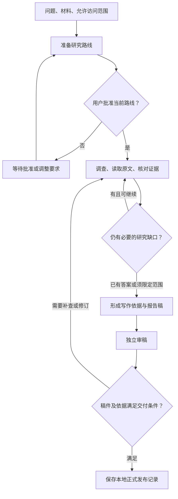
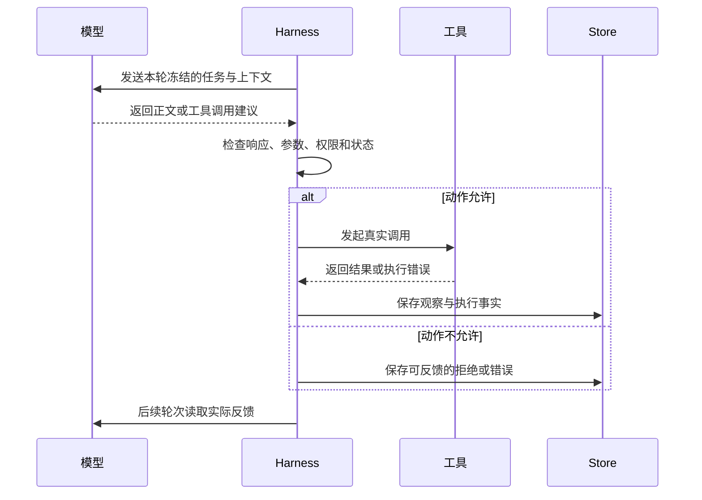
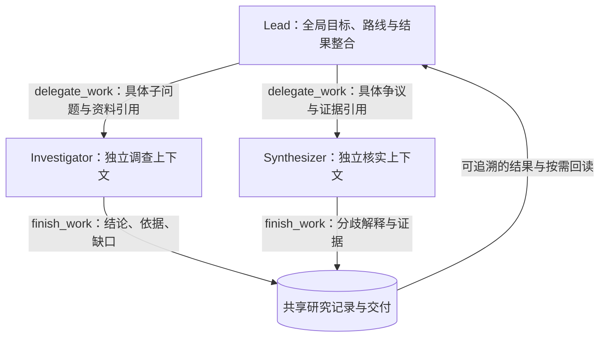
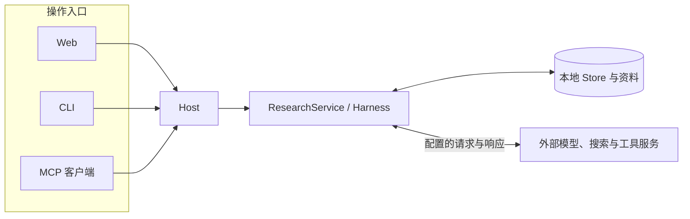

# 01 项目全景

Epivra 是运行在用户电脑上的自主研究工作台。用户给出问题、材料和允许使用的能力，确认研究路线后，系统可以持续查找资料、核对冲突、必要时计算，再写成有依据的报告并安排独立审稿。研究过程不依赖浏览器页面一直打开，但也不代表电脑关机后仍有云端任务在执行。

理解这个项目，首先要回答一个问题：**模型可以提出很多合理的研究动作，程序怎样把其中获准的动作真正执行，并留下足以核查和恢复的记录？**

本章先沿一项研究走完整体流程，再解释模型与程序的分工、为什么需要 Agent、用户授权的边界，以及本地运行究竟意味着什么。后面各章会把这里出现的机制逐一展开。

## 01.1 一项研究怎样走到交付

设想用户提出问题：“比较主从式和去中心化多 Agent 架构在复杂研究任务中的适用条件，并说明各自的风险。”这只是一个帮助理解流程的例子，并非 Epivra 已经执行过的一次研究。

如果直接让模型回答，它可以凭输入内容生成一篇文章，但未必真的核对了来源，也无法从生成文字本身判断它是否已经查到关键反例。Epivra 要处理的是另一种任务：研究路线可以在执行中根据真实资料不断修正，结论需要能追溯到具体来源，任务中断后也要知道哪些工作已经发生。

一项研究大致经过以下阶段：

这张图刻意把**调查是否充分**与**稿件能否交付**分成两个判断。调查阶段可能得出“目前只能有限回答”的结论；审稿阶段也可能发现报告省略了关键条件，要求回到研究环节补查。它不是机械执行一次搜索、一次写作和一次审核的固定流水线。

### 先确定问题与边界，再决定怎么查

用户最初提供的是研究需求，不是无限制的权限。研究问题、选中的材料、目录授权和能力开关共同限定调查范围。

创建研究后，系统会准备一份路线，说明准备回答哪些子问题、使用哪些允许的材料以及怎样覆盖需求。用户批准的是**这一份具体路线与当时的执行约束**，而不是授权模型以后任意读取电脑文件或任意调用外部服务。

路线准备本身需要模型参与，因而批准之前也可能产生模型调用费用。只是这一阶段的调查工具受到限制：不能把“已在准备路线”说成“已获准联网取证、读取全部来源正文或委派助手”。

### 研究过程中，结论必须留得下依据

用户提出的架构比较问题可以沿系统原理、实际案例、性能口径与可靠性证据等方向展开。Lead 根据研究进展组织不同方向的调查，独立助手在自己的上下文中深入查找资料，交回经过组织的结论和原始依据。这样，负责人能持续关注整体问题，不必把每一条局部搜索轨迹都纳入自己的模型输入。

调查过程不只保留最终答案，还要保存实际取得的来源、关键原文位置、研究判断及其成立条件、必要的计算产物，以及尚未解决的问题。例如“某架构更快”只有在任务、模型、预算和衡量口径明确时才是可讨论的判断；不能仅因为网页摘要里出现了类似句子，就把它写成普遍事实。

助手的交付记录让 Lead 能按原始引用回查关键条件、协调分歧、决定继续补查还是进入写作。调查形成的是逐步积累的研究成果，而不只是一次次聊天回复。

### 写完不等于交付

写作阶段把经过调查的材料组织成报告，并绑定它使用的依据。独立 Reviewer 检查**某一具体稿件版本**是否忠实使用资料、是否忽略重要限制、有没有超出证据的推论。

Reviewer 是承担独立检查职责的模型工作，不是真人员工，也不能保证发现全部事实错误。它的审阅结论属于特定稿件：稿件修改以后，旧稿通过的审查不能直接替新稿作保。

最后还有一层程序交付校验，检查当前研究方向、写作者资格、稿件版本、依据与审稿记录是否匹配。通过后，系统保存本地的 publication（发布记录）。这里的发布表示**研究已在本机确认交付**，不代表报告被自动公开到互联网。

## 01.2 模型提出动作，程序负责执行

持续研究中最容易混淆的是“模型说自己做过”和“程序确实完成了”。

假设模型返回：“我需要搜索主从式多 Agent 的生产实践”，并给出某个搜索工具的名称和查询参数。这个响应只是**动作建议**。如果程序没有接收、检查并调用工具，就没有实际搜索结果。更不能因为模型随后写出“经调查发现”，便推断调查真的发生过。

Epivra 把两种职责分开：

| 工作 | 模型做什么 | 程序做什么 |
| --- | --- | --- |
| 选择下一步 | 判断哪些问题缺证据，提出搜索、读取或计算动作 | 提供当前可用的工具定义和任务约束 |
| 执行动作 | 给出工具名与参数 | 检查响应完整性、Schema、角色权限、研究状态，再实际调用 |
| 接收结果 | 解释真实返回的来源、数据或错误，决定后续动作 | 保存结果或错误，并把可使用的信息交给下一轮 |
| 形成成果 | 综合调查、写作和提出完成建议 | 检查工作终结动作、稿件版本、审阅及发布条件 |

把“检查”放在真实执行之前非常重要。即使模型输出了一个格式正确的工具调用，仍然可能因为当前路线尚未批准、当前角色没有权限、参数引用不存在，或用户已经暂停研究而被拒绝。

这里的 Harness 是执行层：它把模型接口、工具权限、执行与持久化连接起来。上图只展示工具调用分支；模型也可能直接返回正文，但返回正文并不能自动结束 Work，更不等于整项研究已交付。

这种分离既给模型保留了根据新信息改变调查方向的自由，也让程序有机会阻止越权动作、核对状态，并记录**实际发生了什么**。

## 01.3 Agent Loop 与多 Agent：持续调查与上下文治理

复杂研究的困难不只是“需要多搜索几次”。每获得一份新材料，系统对原问题的理解就可能变化：原本看似一致的观点可能采用不同指标，某个关键结论可能缺少适用条件，已有结果也可能引出新的核查任务。Epivra 需要让调查随证据推进，同时避免大量工具结果和局部推导不断占满负责人的模型上下文。

为此，项目结合了两种互补机制：**Agent Loop 负责根据反馈持续推进工作，多 Agent 通过独立工作上下文组织不同方向的深入调查。**

### Agent Loop：让每一步研究建立在实际反馈上

在 Epivra 中，一份 Work 可以经历多轮模型调用。每轮由 Harness 整理任务、已有记录、工作记忆和当前可用工具，模型据此提出下一步动作，程序检查后执行，再把真实结果保存为 observation（观察记录），供下一轮继续判断。

**装配上下文 → 模型判断 → 执行获准动作 → 保存观察 → 更新判断。**

例如，为了比较两种多 Agent 架构，负责人先取得几份架构资料，发现不同作者对“协调开销”的衡量口径不一致。下一轮的合理动作就不是重复生成摘要，而是读取各自的实验条件与原文，必要时请求计算或委派独立核查。新一轮决策来自已经取得的材料，而非最初的一份固定步骤表。

这个循环让模型决定研究动作，程序则负责工具权限、调用事实、工作状态及交付条件。二者相互配合，使研究能根据证据变化，又保留执行过程的可核查性。

### 多 Agent：既是任务协作，也是上下文工程

如果所有调查都由同一份 Work 连续完成，负责人不仅要处理全局问题，还要反复接收各个方向的搜索结果、原文片段、计算记录和分歧核实过程。随着研究展开，大量局部细节会竞争同一个上下文窗口，削弱对总问题、关键证据与未解决缺口的关注。

Epivra 采用**单层主从式协作**来组织这类信息。Lead 持有整体目标和最终判断职责，Investigator、Synthesizer 等助手在各自的 Work 中处理边界明确的子问题。每个 Work 都有独立任务、模型轮次与工作记忆，因此一个助手可以深入阅读大量专业材料，不必把全部探索轨迹直接压入 Lead 的输入。

助手完成后通过 `finish_work` 交回 work_result（工作交付记录），将局部结论、原始依据引用与尚存缺口带回负责人。Lead 接收的是**可复用、可追溯的研究成果**，而不是每个助手完整的私有对话；需要复核时，又能沿引用读取持久保存的原文。

这套协作带来三个相互联系的效果：**独立调查能够并行推进；局部上下文不必全部挤进主 Agent 的窗口；跨角色交接保留了原始资料的准确引用。** 上下文隔离与共享研究记录并不矛盾：隔离的是各个 Work 的工作过程和默认模型输入，共享的是经授权、能够回读的资料与正式研究成果。

### 为什么还需要聚焦装配、工作记忆和澄清

仅仅创建独立 Work，还不足以解决信息传递问题。Epivra 在委派时保存任务用途、交付要求和相关资料引用，`_focused_research_refs` 在准备助手上下文时优先筛选与当前问题直接相关的记录。助手也可以通过 `read_context` 访问共享研究目录，按需回读未直接放入窗口的材料。

长任务仍会遇到上下文增长，因此每份工作还配合历史清理、`save_memory` 工作记忆和压缩检查点，使局部研究能够跨越多轮模型输入持续推进。当任务缺少必须由负责人统一决定的前提时，助手使用 `request_clarification` 保存问题并等待答复，避免在不明确的条件下继续调查；答复再进入原 Work 的后续上下文。

这些机制的分工是清晰的：

- **多 Agent 分工**组织不同问题的独立探索空间。
- **聚焦上下文与引用回读**决定当前模型真正需要看到哪些材料。
- **工作记忆与压缩检查点**帮助单份 Work 延续长时间的研究。
- **持久化交付与澄清**让不同 Work 能协作，而不依赖复制彼此的全部对话。

Anthropic 的官方文章 [Effective context engineering for AI agents](https://www.anthropic.com/engineering/effective-context-engineering-for-ai-agents) 将上下文压缩、结构化笔记和多 Agent 架构共同视为长任务上下文治理的重要方法；其 [How we built our multi-agent research system](https://www.anthropic.com/engineering/multi-agent-research-system) 进一步解释了主从研究协作中，子 Agent 用独立窗口探索、再向负责人浓缩交付的价值。它们为理解这类架构提供了工程依据；本节关于 Epivra 的行为则以项目自身实现为准，不将其他系统的评测数据当作 Epivra 的实测结果。

Epivra 的具体协作拓扑是**单层委派**：只有 Lead 能创建助手，由 Lead 负责跨子任务整合与最终交付。写作助手、独立审稿和分歧核查分别承担后续所需的职责，研究不必机械经过固定的角色流水线。第 04 章将从任务与上下文的实际装配、消息交接、等待与调度展开这些实现。

## 01.4 用户批准与研究状态：控制权属于谁

研究是一项可以继续打开和检查的长期任务，而不是一轮聊天消息。为了说清不同工作、材料与稿件的归属，Epivra 保存几种重要记录：

| 记录 | 作用 |
| --- | --- |
| **Study** | 识别这是哪一项研究 |
| **Direction** | 固定这一次研究的目标、策略及允许范围 |
| **Work** | 识别负责人或助手当前要完成的工作 |
| **Artifact** | 保存来源、判断、稿件等可回查的研究产物 |
| **Control** | 保存批准、暂停、取消以及控制版本和 Epoch |

这些对象不是按表格顺序依次创建的流水线。Study 是总身份，Direction 确定当前要求，Work 记录任务，Artifact 保存事实与产物，Control 则持续限制哪些执行还有效。

### 文件导入与目录授权不同

导入一份 PDF，允许研究使用的是这份材料；授权一个目录，才允许系统在这个明确范围内按需发现、读取更多文件。仅凭研究问题提到了某个文件夹，模型不会自动得到读取许可。

外部 MCP 工具也遵循自己的授权边界：一个已经获准连接的外部服务可能拥有它自己的网络能力，因此禁用 Epivra 内建网络渠道，并不等于所有外部连接从此无法联网。实际可访问范围必须同时看研究策略、工具配置和外部服务的能力。

### 用户改向后，旧请求返回怎么办

考虑这个时间线：

1. 研究已经批准，负责人发出读取请求。
2. 在请求返回之前，用户暂停研究或改变问题。
3. 外部请求随后返回了一个结果。

返回结果本身不能使旧工作重新获得执行权限。程序使用 Control 中的版本和 Epoch（控制轮次）识别有效执行范围，保留已发生调用的回执，再判断它还能否影响当前工作。

这不是简单地“把迟到响应丢掉”。远端可能已经执行或计费，事实应该留下；但旧资格不能继续提交当前方向的成果。第 08 章会把这种分离与 SQLite 事务、操作账本、重放和恢复联系起来。

## 01.5 本地运行的边界

Epivra 在本机由 Host 持续管理研究、工作区和存储，浏览器只是操作与查看的界面。另有 CLI 与 MCP 服务入口，它们最终都使用相同的研究宿主与底层约束。

**关闭浏览器标签页不等于停止研究。** 只要本地宿主仍在运行，后台就可以继续推进。但退出宿主、电脑休眠或关机，会影响本机执行；之后能否继续，要看原来的状态、已完成回执和执行环境是否满足恢复条件。

**本地保存不等于全部离线。** 使用外部模型、搜索、Jev 或 MCP 服务时，相关问题、上下文或工具参数仍可能发送到对应服务。将研究保存在本机，只说明状态与资料的主要存放位置，不代表外部没有得到任何内容。

**保存用量不等于控制总费用。** Epivra 能记录供应商返回的用量，却不因此知道完整账单。当前基线没有保证整项研究的总费用上限；长任务持续获得新材料时，也可能继续消耗模型调用。

**可追溯不等于结论必然正确。** Store 能保存材料和版本，程序能检查引用身份与交付关系，Reviewer 可以检查部分事实使用错误；但资料可能过时，原文可能被误读，计算假设也可能不成立。重要结论仍要回到原始来源和适用条件。

## 本章小结

现在可以用五个关系把 Epivra 的全局模型串起来：

1. **用户决定问题与授权边界**，模型不能凭一段提示词扩大权限。
2. **模型决定建议做什么**，Harness 检查并执行，真实结果才能进入后续判断。
3. **ResearchService 选择推进哪份 Work**，Lead 负责整项研究，助手只负责被委派的范围。
4. **Store 保存实际发生的事实与版本关系**，让来源可回查、控制可核对、长任务有条件恢复。
5. **报告通过审稿和程序发布校验后才算交付**，文字生成、草稿保存和正式发布是不同状态。

下一章不再重复这些定义，而是从一次研究创建开始，追踪 Web/CLI/MCP、Host、ResearchService、Harness 与 Store 之间的实际数据流和控制流，说明它们为何需要这些不同的职责。

## 本章源码索引

- [Host：研究宿主与入口管理](../../src/epivra/host.py)
- [ResearchService：就绪工作、调度与研究终止](../../src/epivra/application.py)
- [Harness：模型轮次、工具校验与观察记录](../../src/epivra/harness.py)
- [Store：Study、Direction、Work、Control、Artifact 与事务](../../src/epivra/storage.py)
- [上下文装配与可回读材料](../../src/epivra/context.py)
- [MCP 外部连接与授权](../../src/epivra/mcp_client.py)
- [MCP 服务入口](../../src/epivra/mcp_server.py)
