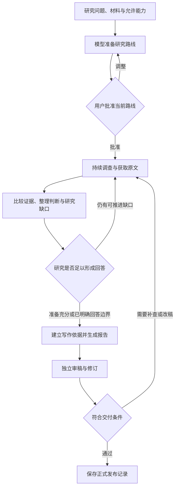
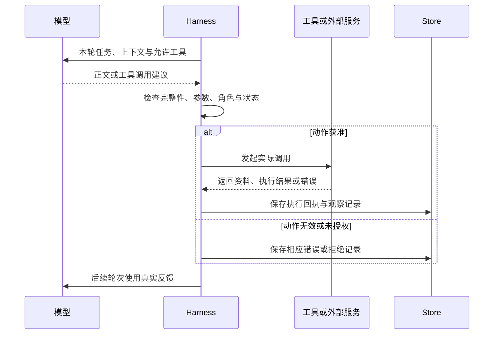
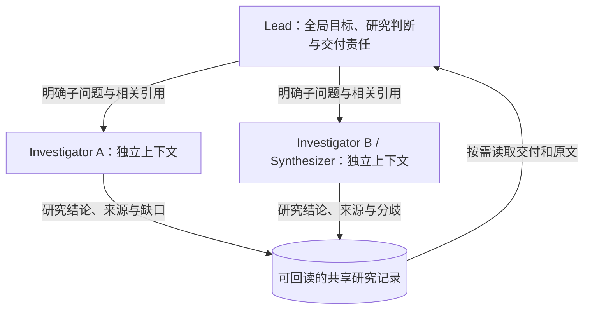
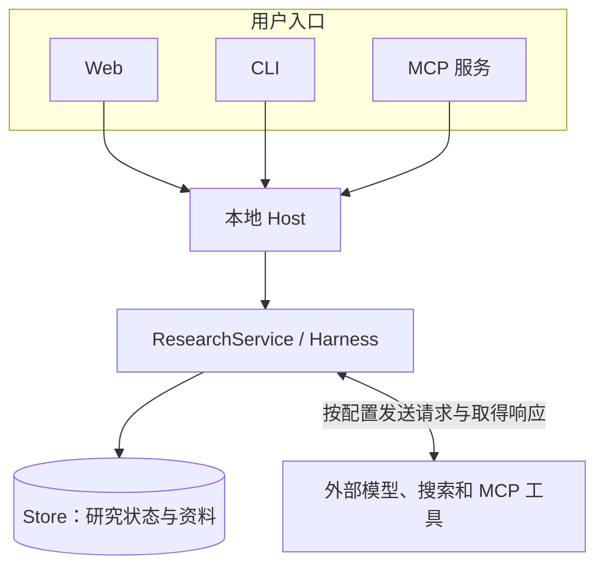

# 01 项目全景

Epivra 是运行在用户电脑上的自主深度研究工作台。用户提出研究问题、选择材料和可用能力，在确认研究路线后，系统能够持续调查、查验原文、比较相互冲突的证据，必要时执行计算，最终形成有来源依据的报告，并交由独立的审稿工作检查。用户可以查看研究进展、暂停任务或调整方向，而不必始终守着浏览器等待一次模型回复。

这项产品要解决的并不是“怎样让模型写出一篇很长的文章”，而是一个更完整的工程问题：**面对需要多次搜集、核查和修正的开放性问题，怎样让模型有能力持续行动，又让每一步的权限、依据、工作进度和最终交付都能被程序管理？**

理解 Epivra，可以先抓住四条彼此衔接的主线：模型根据真实反馈推进调查；多个 Agent 分担不同方向的探索与上下文；研究资料和判断形成可回读的证据链；本地运行时保存状态与回执，使长任务能够受控地持续执行和恢复。本章只建立这套整体模型，具体协议、算法和源码状态转移留到后续章节深入。

## 01.1 一项研究从提出问题到正式交付

设想用户提出一项研究任务：“比较主从式与去中心化多 Agent 架构在复杂研究中的适用场景，分析上下文管理、协调成本和结果可信度，并提供可核查的技术依据。”

这个任务无法仅凭“搜到几篇资料”就认定完成。不同来源对同一架构的定义可能不同，性能实验可能使用不同的模型和任务；有些文章介绍的是设计主张，有些才包含实际运行证据。要写出可靠报告，系统不仅要发现信息，还要决定哪些问题没有得到回答，哪些来源值得继续阅读，以及何时已经具备足够的写作依据。

Epivra 把研究组织成一段可以持续推进的过程：

**首先是路线准备。** 创建研究时，Epivra 保存问题与获准资料范围。以网页工作台为例，先创建暂停的研究草稿并导入初始材料，然后启动路线准备。模型组织要回答的子问题、计划查阅的资料与覆盖方式，用户再批准具体路线。路线准备本身可以使用模型，因此“等待研究批准”并不等于“没有任何模型请求”；批准控制的是后续完整调查的执行范围。

**然后是动态调查。** 研究负责人可以自己搜索和核对，也可以委派明确的子问题。系统保存实际取得的来源、原文位置、研究判断与未解决缺口。新材料可能改变下一步：一份报告只提供摘要，就需要寻找原文；两份资料结论相反，就需要核对衡量口径；已经得到了足够支持，也应当进入整理与写作，而不是机械增加搜索次数。

**最后是写作和交付。** 调查结论被组织为正式写作依据，写作者据此形成报告。独立 Reviewer 对指定版本的稿件及其依据开展审查；有实质问题就修订或补查。通过审稿以后，程序还要检查当前研究方向、写作者身份、稿件及审稿版本、来源引用和交付关系，符合条件后才保存 `publication`（正式发布记录）。这里的“发布”是**本地研究确认交付**，不是自动将内容公开到互联网。

这条流程不是一条只能从左到右的流水线。研究是否继续、何时委派、什么时候补查，取决于真实资料与研究缺口；权限检查、记录保存和发布校验则由程序执行。**开放式研究决策与确定性工程约束共同组成 Epivra 的运行方式。**

## 01.2 为什么 Epivra 是 Agent 系统，而不只是 RAG 或自动写作

先区分三个常见概念。普通模型问答主要根据当前输入生成回答；RAG（Retrieval-Augmented Generation，检索增强生成）在生成前或生成过程中引入外部资料，改善回答的信息依据；Agent 则可以围绕目标，**根据工具执行后得到的反馈，动态决定下一步要做什么**。

Epivra 同时具备资料检索和报告生成能力，但它的研究方式并不止于“检索一次，然后写答案”。例如：

某个 Agent 搜索“多 Agent 与单 Agent 的性能比较”，取得了几份结果。它发现一篇文章谈的是复杂问题的搜索质量，另一篇测量的是任务延迟，二者不能直接比较。下一步，模型可以决定阅读实验方法、补查运行成本，或者让另一份工作独立核验结论。每一步的新行动建立在**已经真实取得的材料**之上。

这个连续反馈过程就是 Agent Loop（智能体执行循环）：

**装配本轮任务与上下文 → 模型判断下一步动作 → 程序检查并执行 → 保存真实观察 → 让模型根据反馈继续判断。**

Anthropic 在 [Building effective agents](https://www.anthropic.com/engineering/building-effective-agents) 中，将由预定义代码路径编排的 Workflow（工作流）与由模型动态决定工具使用过程的 Agent 区分开。Epivra 采用了二者的组合：用户批准的是研究目标与范围，程序负责固定的权限和发布规则，研究过程中具体调查动作则由 Agent 根据证据动态规划。

### 为什么模型和 Harness 必须分工

大语言模型能够决定需要搜索什么、阅读哪份资料或如何解释结果，但模型生成“我已经核对原文”这句话，不等于程序真的读取了任何来源。

在 Epivra 中，模型产生的是**可解释的动作意图**，Harness（运行时执行框架）负责把它变成真正发生的行为。模型提出工具名称和参数后，Harness 检查本轮可用工具、参数格式、角色与研究许可，以及当前任务状态，再调用对应能力。返回的实际材料或错误被保存，之后才进入下一轮模型判断。

这个分工带来两种互补能力：模型能够根据新信息改变研究策略，程序则能够核对**谁在什么条件下执行了什么动作、实际得到了什么结果**。工具调用可以失败，模型也可以返回不完整的参数；这些情况都应该有明确处理，而不是让下一轮模型凭空假定工具已成功。

需要注意的是，模型正文、一次工具调用、一个 Work 的结束与整项 Study 的正式发布分别是不同事件。Harness 能推进一次工作回合，但不会因为模型写出“研究完成”就越过证据、审稿及发布条件。第 03 章将从真实的模型请求和工具回执深入说明这层机制。

## 01.3 多 Agent：让研究分工与上下文治理相互配合

Epivra 采用**一个研究负责人 Lead + 按需委派的专业助手**的主从式协作结构。Lead 管理整体问题，必要时把独立调查、争议核查、写作或审稿交给相应工作。负责人的目标是形成一份统一、可核查的研究报告，而不是单纯收集多个助手各写一段的答案。

多 Agent 在这里至少承担两个相互关联的作用。

**第一个是组织不同方向的深入研究。** 比如前面的架构比较任务，一份 Investigator 工作可以核对性能实验的计算口径，另一份可以搜集生产实践；发现两份依据存在冲突时，还可以委派 Synthesizer 针对分歧开展分析。负责人获得各部分结论和原文引用，再决定哪一项仍需查证。不同方向可以在条件允许时并行，研究也不用机械地经过全部角色。

**第二个是治理上下文。** 每一次模型请求都有有限的输入窗口，研究过程中又不断产生搜索结果、原文片段、局部尝试和计算记录。如果所有调查都放在 Lead 的一份长对话里，全局目标和大量局部细节就会争夺同一个上下文预算。

因此，Epivra 为每份 Work 维护独立的任务、执行历史和工作记忆；助手在自己的上下文中深入查找资料，完成后通过持久化交付把**结果、依据和剩余问题**带回 Lead。负责人不需要接收助手全部私有模型历史，却能根据稳定引用重新读取共享的研究材料。

这是一种**共享事实、不共享全部私有上下文**的协作模式。它使局部探索能够深入进行，也使 Lead 能持续围绕总问题进行规划、整合与决策。Anthropic 在 [Effective context engineering for AI agents](https://www.anthropic.com/engineering/effective-context-engineering-for-ai-agents) 中，把上下文压缩、结构化笔记和子 Agent 架构共同作为长期任务的上下文治理手段；在 [How we built our multi-agent research system](https://www.anthropic.com/engineering/multi-agent-research-system) 中则讨论了负责人组织研究、子 Agent 独立探索及浓缩交付的设计。它们为 Epivra 这类架构提供了工程解释，但其他系统的评测收益不是 Epivra 自己的实测数据。

### 为什么由 Lead 持有全局责任

并不是每个多 Agent 系统都必须采用主从式结构。OpenAI Agents SDK 的 [Agent orchestration](https://openai.github.io/openai-agents-python/multi_agent/) 区分了负责人保留控制权、调用专业 Agent 获取结果的 Manager 模式，以及将当前控制权转移给专业 Agent 的 Handoff 模式。

Epivra 的任务需要把多个来源、分歧判断和最终报告汇总到**同一个研究方向和交付责任**下，因此采用负责人保留总控的方式：子 Agent 处理明确的局部问题，Lead 负责统一研究判断与报告交付。源码中的 Work 通过 `owner` 记录所属关系，存储层限制只有当前 Lead 能够委派子工作，从程序上维持单层主从拓扑。

这种组织方式既能让 Investigator 自主寻找证据，也使“谁有权改变总体判断、谁应该答复助手的澄清、谁最终发布报告”有明确归属。第 04 章会进一步解释聚焦上下文、工作交接、澄清、等待、并发和长期记忆检查点的具体实现。

## 01.4 从来源到结论：为什么需要独立的证据与审稿机制

深度研究的质量不能只用搜索结果数量、模型生成字数或工具成功率衡量。一条检索结果可能只有标题和摘要；取得的网页正文可能只包含一部分；同一数据被多家网站转述，也未必构成多份真正独立的证据。

Epivra 因此把**取得资料**和**证明某个判断**分开管理。

例如，用户要求比较两种架构的性能。某篇文章可能只在特定模型、任务集和预算条件下报告某个架构更快。系统能够保存原始来源与读取位置，但模型若想进一步记录“这种架构具有更好的性能”，仍需要表达它支持的是哪一个具体判断、成立条件是什么、还有哪些限制。正式报告也不能把只在特定条件下成立的结果写成普遍结论。

这条证据链大致表现为：

这张图表示证据逐层用于研究的关系，并不代表每种记录只可能有一个直接前驱。真实调查会引用多个来源、更新旧判断、记录分歧，必要时回到更早的原文重新核查。

**Reviewer 和程序发布校验解决的是两种不同问题。** Reviewer 使用模型阅读指定的报告及必要依据，检查关键事实、论证及遗漏的条件；程序则核对能够确定的结构性条件，如稿件所属方向、当前写作权、审稿是否绑定正确版本、引用是否合法，以及是否具备有效的交付记录。模型负责内容质量判断，程序负责可验证的交付约束，二者共同形成质量控制流程。

一旦稿件发生实质修改，旧的审稿结论不能自动替新版本背书。Epivra 将报告、审稿和发布关系写入持久记录，并由程序检查最新稿件和审稿对应关系。这让研究过程不仅能生成“看起来合理的结论”，还能够回答“这份结论基于什么材料、经过了哪一轮审查”。

第 06 章会讲原文与研究判断的形成，第 07 章会讲写作权、报告版本、审稿与发布。此处先记住最重要的区分：**来源被取得，不等于已被完整阅读；资料被引用，不等于判断得到支持；模型审稿通过，也不代替程序检查交付条件。**

## 01.5 用户授权、本地宿主与长任务可靠性

Epivra 的自主性建立在用户允许的研究范围内。用户决定问题、材料和访问能力；研究系统负责按照当前方向安排工作。以 Web 入口为例，研究在正式调查前经历计划准备和用户批准。批准的不是一张无限权限通行证，而是一个具体研究方向及其已配置的能力范围。

项目用几种不同记录维护长期任务的身份与变化：Study 表示整项研究，Direction 表示当前研究要求和策略，Work 表示负责人或助手承担的具体工作，Source、Finding、Report 等持久产物提供可回读依据，Control 则管理当前批准、暂停、取消和控制轮次。它们在 [Store](../../src/epivra/storage.py) 中关联起来，避免把整个研究仅仅维持为一个会随进程退出而消失的 Python 对象。

这一设计让用户能够暂停或改向，并保留已经发生的资料获取和任务记录。例如，某个外部请求发出后用户改变研究方向，返回结果仍属于此前实际发生的调用；程序可以保存真实回执，但必须重新检查旧 Work 是否还能代表当前方向继续执行。**执行事实是否存在，与现在是否仍允许继续执行，是两个不同的问题。** 第 08 章会完整讲解 Control/Epoch、SQLite 事务、外部操作账本与重启恢复。

### 为什么关闭浏览器不等于终止研究

Epivra 使用本机 Host 作为持续运行的研究宿主。Web、CLI 和向外部客户端提供研究功能的 MCP 服务入口，都把用户操作交给 Host；Host 管理 ResearchService、Harness、Store 与所配置的连接。

浏览器负责呈现研究和发出操作，实际执行由本地 Host 驱动。因此，关闭浏览器标签页不会直接终止后台研究。退出宿主、电脑休眠或关机则会影响本机执行；重启以后，系统依赖已保存的工作状态、来源和操作回执决定怎样接续，而不是企图恢复进程退出前的 Python 函数调用栈。

本地运行也需要正确理解数据流向：研究记录与资料主要保存在用户电脑，使用云端模型、网页搜索或外部 MCP 工具时，相关请求内容仍会发送至相应服务。Epivra 能记录供应商报告的用量，但这不同于完整账单或全研究费用上限。项目的价值在于**让研究宿主、权限和可追溯资料处于本地程序的控制之中**，而不是声称所有推理和获取都必然离线。

## 本章小结

现在可以从整体上回答“Epivra 是一个什么项目”。

Epivra 是一个以本地 Host 为运行主体的多 Agent 深度研究系统。它允许用户明确研究目标和可用能力，批准路线后由 Lead 根据真实资料动态安排调查。Harness 负责让模型建议经过权限和参数检查后成为真实工具执行；不同 Work 在独立上下文中进行局部研究，再通过持久记录与来源引用完成交接。系统将获取的资料组织成可核查的研究判断，以当前写作依据形成报告，并通过独立审稿和程序发布校验完成交付。Store 保留研究状态、执行回执和版本关系，使长任务可以受控暂停、改向与恢复。

理解这个项目时，重要的不是背下组件名称，而是能够解释它们为什么必须协作：**Agent Loop 提供持续探索能力，多 Agent 与上下文工程让探索能够分工而不淹没全局，证据体系支撑报告可信度，持久运行时负责权限、状态与恢复。**

下一章将沿一条真实研究操作的调用链，展开 Host、ResearchService、Harness 和 Store 的架构职责、数据库状态和命令处理边界。

## 本章源码索引

- [Host：本地研究宿主、入口和命令处理](../../src/epivra/host.py)
- [ResearchService：Lead 与子 Work 的调度及交付](../../src/epivra/application.py)
- [Harness：模型轮次、工具执行及角色能力](../../src/epivra/harness.py)
- [Store：研究身份、批准控制、持久记录与发布校验](../../src/epivra/storage.py)
- [Context：上下文装配和可回读引用](../../src/epivra/context.py)
- [ResearchLedger：研究判断、核查与写作依据](../../src/epivra/research.py)
- [WritingWorkspace：稿件版本和当前写作权](../../src/epivra/writing.py)
- [MCP Client：外部能力连接与发现](../../src/epivra/mcp_client.py)
- [MCP Server：向外部客户端提供研究入口](../../src/epivra/mcp_server.py)

## 延伸阅读

- [Anthropic · Building effective agents](https://www.anthropic.com/engineering/building-effective-agents)：Agent 与固定 Workflow 的控制方式，以及主从委派和反馈式研究。
- [Anthropic · Effective context engineering for AI agents](https://www.anthropic.com/engineering/effective-context-engineering-for-ai-agents)：多 Agent、结构化笔记与压缩共同组成的上下文治理。
- [Anthropic · How we built our multi-agent research system](https://www.anthropic.com/engineering/multi-agent-research-system)：负责人和子 Agent 的研究分工、独立上下文与结果浓缩。
- [OpenAI Agents SDK · Agent orchestration](https://openai.github.io/openai-agents-python/multi_agent/)：Manager 与 Handoff 两类常见协作控制方式。
