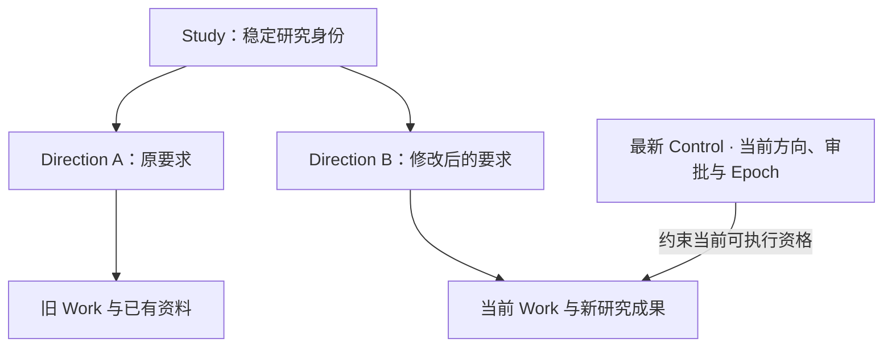
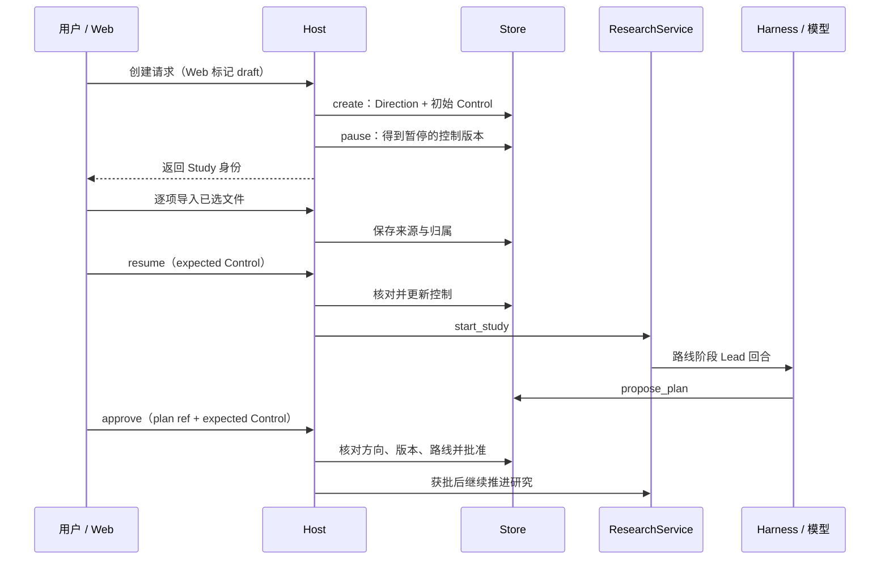
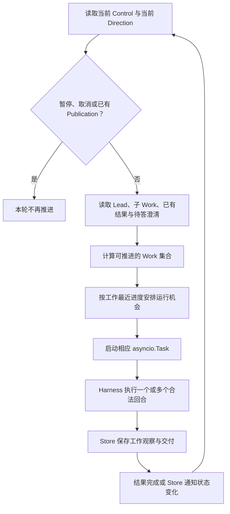
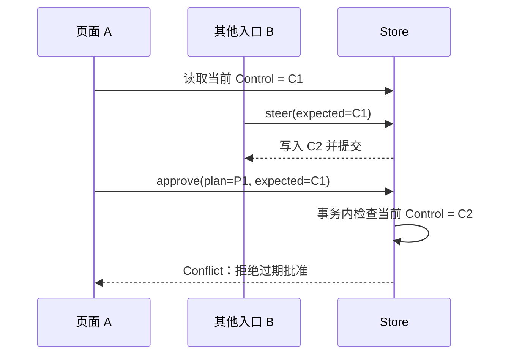
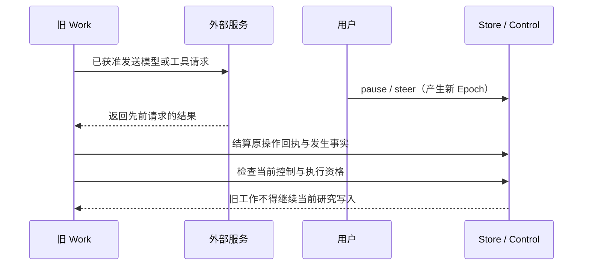
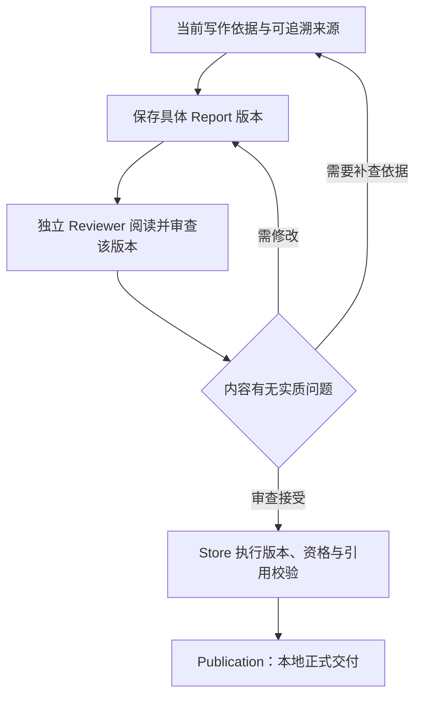

# 02 整体架构与任务流程

第 01 章已经建立了 Epivra 的整体模型：Lead 负责研究方向，Harness 把模型提出的动作变成受控执行，多份 Work 通过持久资料与结果交接形成同一份报告。接下来要追问的是：**这样一个可以持续运行、让用户随时暂停改向的研究系统，究竟由哪些程序共同承担？如果一条命令与一个模型响应在时间上交错，谁负责保证结果仍然正确？**

本章始终围绕一项研究展开。先从界面上的“创建研究”走到本机 Host，再沿着批准、调度、工具执行、助手交付与正式发布走完全程。在这条主线上理解研究对象、SQLite 事务、Python 异步任务和浏览器并发控制，不需要先背一张模块清单。

## 02.1 从网页到后台：五种职责为何必须分开

用户在浏览器中点击“创建研究”，看到的似乎是一次普通 HTTP 请求。但 Epivra 的网页并不直接拥有 Agent，它只是本地研究宿主的一种操作入口。实际调用关系如下：

```mermaid
flowchart TD
    subgraph UI["操作入口"]
        B["浏览器 · web/app.js"]
        C["CLI"]
        M["MCP 服务入口"]
    end
    B --> G["Web 门面 · webui.py"]
    G -->|"本机 IPC · host.send"| H["Host · 命令分派与研究宿主"]
    C -->|"host.send"| H
    M -->|"host.send"| H
    H --> S[("Store · SQLite 持久事实")]
    H --> R["ResearchService · 工作就绪与推进"]
    R <--> S
    R --> X["Harness · 单个 Work 的模型与工具回合"]
    X <--> S
    X <--> P["模型 / 搜索 / MCP / 受限分析"]
    H -->|"状态与报告查询"| G
    G --> B
```

这里的五种职责，是**入口、宿主、研究调度、Agent 执行和持久存储**。它们的边界来自状态寿命与错误处理方式，而不是为了让代码看起来更分层。

浏览器的 `web/app.js` 处理按钮、文件选择、弹窗和状态展示；`webui.py` 提供本机 HTTP 服务，校验允许的操作及参数，再通过 `host.send` 把命令发给宿主。通信使用本机回环地址上的 IPC（进程间通信）：请求携带本地宿主令牌，Host 校验后交给 `dispatch`。Web 门面并不自己启动一个新的研究循环。CLI 与 MCP 服务入口也复用宿主的研究命令，入口可以不同，最终处理研究权限与状态的地方却相同。

**Host 负责活着的服务。** 它维护 Store、研究服务实例、外部客户端连接、共享运行名额及资源清理。当用户关闭浏览器标签页时，后台宿主并没有因此消失；Host 可以继续驱动已经获准、未被暂停的研究。反过来，关闭本地 Host 或电脑休眠会影响本机执行，不能把“后台运行”理解成远端云服务永久托管。

**ResearchService 负责决定哪份工作现在可以推进。** 一个研究可能有 Lead、多个调查助手和等待审稿的工作。是否暂停、是否已正式发布、子 Work 是否结束、是否收到澄清答复，都会影响当前可运行集合。ResearchService 不负责解释每一家模型的流式协议，也不亲自执行 MCP 工具。

**Harness 负责推进选定 Work 的一轮。** 它装配该角色需要的上下文，创建和冻结模型请求，校验完整响应与工具动作，发出获准调用，最终把结果写回 Store。它既能服务 Lead，也能服务 Investigator、Writer、Reviewer；角色变化通过 Work 的任务与工具权限体现。

**Store 负责长期真实状态与业务规则。** 研究方向、控制命令、工作、资料、外部操作状态与正式报告关系，都可以在本地持久化查询。ResearchService 和 Harness 不是各自维护一份独立的事实真相，而是共同以 Store 为依据。

这套划分特别适合持续研究：网页请求可以结束，研究任务继续；临时调度队列可以重新建立，已确认的工具回执继续保留；新入口可以加入，而不必复制一套权限和交付逻辑。

## 02.2 先理解研究身份，再看它怎样变化

假设用户要调查“多 Agent 架构的上下文治理”。研究开始后，可能生成路线、委派两个助手、获取十份来源、修改方向并反复修订报告。如果只保存聊天消息，很难回答“这条结论属于哪次要求”“这个助手是否仍获准运行”“审稿核对的是哪份稿件”。

Epivra 以几类记录把这些问题分开：

| 记录 | 它回答的核心问题 | 在这个研究中的例子 |
| --- | --- | --- |
| Study | 这是哪项研究？ | Host 创建的研究身份 |
| Direction | 目前要求回答什么、允许使用哪些能力？ | 固定的研究问题和配置 |
| Control | 此刻批准、暂停、取消与控制轮次是什么？ | 当前 Direction、控制版本和 Epoch |
| Work | 谁承担哪项具体工作？ | Lead 或被委派的 Investigator |
| Artifact | 已经形成了什么可回查的事实和成果？ | Source、Observation、Finding、Report 等 |

Study 的身份由 Host 创建并贯穿同一研究；Direction、Control、Work 以及各种研究产物通过 Store 的持久记录相互关联。**同一 Study 可以经历多个 Direction；同一 Direction 可以包含多个 Work；一份 Work 又可以执行多个模型 step。** 把这三种寿命不同的对象理解成一个“当前任务”，就无法处理用户改向后的旧工作。

Artifact 的基本结构包含 `ref`（稳定引用）、`study`、`kind`、`body`（内容）、`parents`（上游引用）和 `seq`（记录序号）。Store 的 `_put` 用研究身份、类型、内容和上游引用计算内容身份，以 `INSERT OR IGNORE` 写入。相同内容与上游关系对应相同引用，不会因为同一写入被重复请求就产生一份语义相同的新版本；内容或依据变化，则会得到新的记录身份。

这里需要区分三个经常混淆的量：

- **ref** 用于确认“到底是哪一份记录”，与文件名或页面位置不同。
- **parents** 用于追溯“这份记录依赖什么”，让工作交付与来源、稿件与审阅可以形成可核验的关系。
- **seq** 用于识别“哪个记录先进入当前存储序列”，它不是用来代替当前研究控制状态的权限令牌。

例如，用户已经从研究性能改为研究安全性。旧来源仍可能有查阅价值，但旧 Direction 下的 Work 不能仅因为共享一个 Study 就自动继续替新方向写结论。真正可执行的是 Control 指向的当前要求与满足其状态检查的 Work。

所以，Store 中**资料已经存在**和**某个 Agent 现在有资格执行**是两种不同的判断。资料身份与可执行资格分开，才可能保留真实研究历史，同时让用户控制当前研究。

## 02.3 创建研究：从暂停草稿到获得研究许可

原 DOCX 将这一段设计为四步，是很好的阅读顺序，值得保留。关键是解释每一步改变的状态，而不是把它们缩写成“创建并启动”。

**创建草稿。** 网页从用户问题、模型配置、资料选择与已配置的外部能力构造创建命令。Host 校验配置，生成 Study 身份，将 Direction 和初始 Control 写入 Store。Store 初次创建的 Control 是尚未批准、未暂停的初始控制；**Web 门面额外要求 `draft=True`，Host 随即记录一次 `pause` 命令**，因此网页返回的是可继续准备材料的暂停草稿。这一点比笼统说“Store.create 创建暂停研究”更符合源码。

**导入已选材料。** 网页拿到明确的 Study 身份后，才把待处理文件逐项归到这份研究并导入；成功的一项从待处理列表移除，失败的一项保留供用户处理。文件被导入，并不代表模型已经读过全文。授权目录与导入单个文件也不是同一种许可：前者允许在指定范围内按需发现文件，后者仅提供所选材料。

**恢复路线准备。** 资料就绪后，页面提交带着当前 Control 引用的 `resume` 命令。Host 更新控制并启动 ResearchService；因当前研究还未批准，服务只推进路线阶段的 Lead Work。模型可以组织问题、概述允许材料并通过 `propose_plan` 保存研究路线，但工具集合尚未包含正式研究所需的全部搜索、原文取证或助手委派能力。

**批准具体路线。** 页面展示当前 Plan 并保存用户当时看到的 Control 引用，确认时同时提交 `plan` 和 `expected`。Store 在一个事务里验证计划属于当前方向、控制版本仍匹配，才记录批准并关联路线。模型接下来才获得执行完整研究工具的资格。

这份流程为什么不是一次 HTTP 请求完成？因为创建研究、准备资料、生成路线、用户确认本来就发生在不同时间。特别是路线需要得到用户授权，不能在尚未核准的情况下自动把资料查阅扩展为完整调查。MCP 对外创建入口也返回暂停草稿，但外部客户端要自行安排导入与恢复，底层审批合同仍然统一。

**审批与运行并不是同一个开关。** 如果用户在研究暂停时批准了路线，批准会保留当前暂停状态；只有之后继续，才会启动正式研究。改变研究方向也要区分“修改研究问题”和“增加新的权限”：现有 `steer` 保存新 Direction，并沿用原有策略与批准控制，而不是悄悄扩大文件或外部工具授权。

## 02.4 调度：为什么“可继续的 Work”和“正在运行的 Task”不同

路线获批以后，系统就进入持续调查。这里最容易混淆的是**持久化工作记录 Work**与**Python 当前进程中的异步任务 `asyncio.Task`**。

Work 描述谁要完成什么、归属哪个 Direction，以及完成或等待的持久依据。一个 Work 可以经历许多模型回合，也可以因内部澄清暂时停下。Task 则是 Python 事件循环对当前协程执行的管理对象：任务创建以后可以被等待、取消或运行到结束，但进程退出后那个 Task 本身不会被恢复。

ResearchService 的主要工作是根据持久事实**重新计算就绪集合**。它在当前 Epoch 中检查研究是否暂停、取消或已经发布，再读取负责人和助手的工作记录。未完成并且没有被错误阻断的助手可以进入候选；正在等待内部澄清的 Work 不应被正常派发；负责人若明确等待子工作，在没有新结果或澄清时也可以暂停自己的模型回合。

在 [`application.py`](../../src/epivra/application.py) 中，ResearchService 为可运行 Work 创建 `asyncio.Task`，并用 `asyncio.wait(..., return_when=FIRST_COMPLETED)` 等待任务完成或者持久状态变更通知。这样，一个助手已经交付、负责人收到新的澄清，或者用户更新控制后，服务都可以重新计算接下来的工作，而不是固定睡眠若干秒后再看一次。

在调度到真正执行之间，系统仍要核对 Work 的资格。每个回合还保存 `agent_attempt` 和 `agent_attempt_end` 之类的尝试记录，帮助解释某轮何时进入、怎样退出。尝试记录与模型/工具的实际发送回执不同：协程已经开始，并不保证远端请求已经发出。

### 两个助手的交接实例

假设 Lead 委派 A 核查性能实验，委派 B 核查安全边界。A 先完成并保存 `work_result`，B 仍在等待远程来源。ResearchService 会把 A 的持久交付整理为 Lead 可读取的 Observation，使负责人知道 A 的成果已到达；B 仍是一份未完成工作，不会被推测为已经成功。

因此，**Work 记录责任、work_result 记录实际交付、Observation 记录另一份 Work 获得了这项反馈**。它们不是三份重复的聊天摘要，也不是内存中 `asyncio.Task` 的别名。A 的具体成果可以沿引用核查，Lead 决定是否继续推进其他研究方向。跨工作信息组织和上下文聚焦由第 04 章深入展开。

Epivra 还有独立的进程内 `AgentRuntime` 来管理多个 Study 的公平运行机会，外部模型和工具另外受资源 Scheduler 的并发与速率约束。这里要区分三个问题：**谁在业务上就绪，谁拿到本机运行机会，什么时候获准真正向供应商发送请求**。研究就绪不等于立刻占有供应商额度，也不等于新启动的 Task 已产生付费调用。

## 02.5 事务：研究状态的原子性怎样落实到 SQLite

前面多次提到“控制版本仍然有效”。要理解它为什么可靠，需要回到 Store 的数据库事务。

设想用户在网页上看到了路线 `P1` 和控制版本 `C1`。他准备点击批准时，另一个入口已经把研究改成新方向，并产生控制 `C2`。如果应用只是先读一次当前版本、隔一段时间再写批准，旧页面就可能批准过期的路线。这就是典型的**检查与写入之间发生并发变化**的问题。

Epivra 的 `Store.command` 在事务内部查询当前 Control，并对比请求中的 `expected`；一致时才检查具体操作的业务条件，并在同一次事务里写入新 Control 和命令回执。版本不一致就拒绝，不能由浏览器“刚才显示过这个按钮”来替后台作保证。

### 为什么使用 BEGIN IMMEDIATE

[`Store.transaction`](../../src/epivra/storage.py) 使用 SQLite 的 `BEGIN IMMEDIATE` 开始写事务，然后在成功时 `COMMIT`、出现异常时 `ROLLBACK`。与默认的 `BEGIN DEFERRED` 相比，IMMEDIATE 会尽早尝试取得写事务资格，让本次读取业务前提与后续写入处于同一写事务中，而不是先读、等到真正写入时才尝试升级事务。SQLite 的 [官方事务文档](https://www.sqlite.org/lang_transaction.html) 说明，已有其他连接持有写事务时，`BEGIN IMMEDIATE` 也可能返回 `SQLITE_BUSY`；这并不是“数据库锁永远不会冲突”的保证。

Epivra 还把数据库设为 WAL（Write-Ahead Logging，预写日志）模式，并启用 `synchronous=FULL`。WAL 有利于读写并存，FULL 用于加强已提交事务的持久性约束。数据库打开时还有单活宿主文件锁，防止两个 Host 同时把自己当成同一工作区的唯一研究主人。这里的三个措施分别解决**读写并发、持久保存与运行所有权**，不能相互替代。

### 命令回执为什么也是事务的一部分

只检查 Control 版本仍不足以处理重复提交：客户端可能已成功发送 `pause`，但网络中断导致没有收到响应。它无法从“我没收到”推出“后台没执行”。

`Store.command` 接受 `command_id`。如果数据库已保存相同 ID 且内容完全一致的命令，系统返回原先保存的 Control 回执，而不是再增加一次 Epoch；如果相同 ID 对应不同内容，则拒绝复用。这是**命令级幂等性**，使同一命令重放有确定结果。

但是，网页通常为每次新提交生成新的 `command_id`。因此，**用户手动重新点击不是天然的同一命令重放**：如果旧提交已经成功，新命令带着过期 Control，很可能遇到版本冲突。页面正确的处理方式是先读取最新状态，确认旧命令是否已经生效，再决定下一步。创建研究的响应丢失也不能未经确认就自动重新创建一项 Study。

事务完成后，Store 才通知等待相应 Study 变化的运行逻辑。因此 ResearchService 得知的是**已提交的新状态**，而不是一个可能还会回滚的中间写入。至此，UI 的版本检查、数据库原子提交、命令回执与异步唤醒构成了一条完整的正确性链。

## 02.6 控制轮次与远端调用：为什么 SQLite 事务不能包办一切

SQLite 可以在一次本地事务中原子保存控制和记录，却无法让远端模型、搜索或 MCP Server 与本机数据库共同执行一个分布式事务。假设 Harness 向外部模型发出了请求，同时用户点击暂停，远端仍可能继续执行并返回数据；数据库没有能力凭一次 `ROLLBACK` 把已经发生的远端计费或写入撤回。

Epivra 因此把两个判断拆开：**外部操作是否真实发生、当前 Work 是否仍有资格采纳结果并继续推进**。

Control 带有 `epoch`，合法的控制命令产生新的控制版本与轮次。ResearchService 检测到控制变化后，停止继续接纳旧轮次的研究工作，并在既有活动回合结算后决定是否进入新轮次。Harness 和 Store 在执行或写入时检查当前 Epoch 与工作归属；旧轮次迟到的结果不能自动变成当前方向的新判断。

如果远端调用已发出、本地却没有得到确定结果，就不能简单通过“再运行一遍异步函数”恢复。操作账本需要保留请求与结果状态，Harness 再按已确认事实决定是重放原回执、允许安全重试，还是阻断等待核实。第 08 章将完整说明这些恢复合同。

这还解释了为什么**进程内锁、数据库事务和 Epoch 各司其职**：进程内锁协调一个进程中重复执行的协程；SQLite 事务保证本地记录原子提交；Epoch 约束旧工作对当前研究的写入资格；远端已发生但未知的副作用仍需要操作级回执和恢复策略。任何一种机制都不能独自替代其他几种。

## 02.7 写作与发布：为何业务完成不等于某个协程完成

研究服务最终要识别的完成状态，并不是“所有异步函数已经 return”或“模型给出一段完整正文”，而是当前 Direction 下存在满足条件的正式发布记录。

写作开始前，研究系统形成有效写作依据；Lead 或获得正式写作权的 Writer 生成一份明确版本的 Report。该报告必须能回到其证据与来源。Reviewer 是独立的审查 Work，需要检查**绑定的特定报告版本**；修改稿件之后，旧稿接受记录不能直接被借给新稿。

Store 的 `publish` 并不只检查 `review.accepted=True`，还核对发起发布的是当前 Lead、当前 Writer 是否已交还写作权、稿件来源和归属是否正确、稿件是不是当前有效版本、审稿是否是独立的最终审稿，以及必要的报告内容是否确实送达 Reviewer 的模型输入。相关依据在审稿后发生实质修订，也需要重新取得符合要求的审查关系。

这里的两层审核并不重复。Reviewer 使用模型检查内容是否忠实于材料、是否遗漏关键约束；Store 检查能够确定的身份、版本、引用与交付规则。技术面试问“如何保证研究质量”，应当解释这个**内容判断与程序不变量共同构成的交付闭环**，而不能宣称一份程序发布记录本身证明了每句事实都真实。

## 02.8 页面并发：为什么“显示最新”与“执行正确”是两道关

用户切换研究、刷新状态、打开批准弹窗时，浏览器可能同时保留多个在途请求。假设页面先请求 Study A 的状态，又切换到 Study B；A 的响应最后才返回。如果 UI 按响应到达顺序渲染，就可能把 A 的数据画到 B 的界面上。

[`web/app.js`](../../src/epivra/web/app.js) 使用当前 Study 身份和 `statusSerial` 检查读取结果是否仍属于最新页面状态；相同 Study 的在途请求可以共用，降低短时间重复状态读取。轮询在上一轮结束后约三秒安排下一次；页面隐藏或正在修改状态时可以跳过刷新。**轮询只是更新界面，不是驱动模型执行的定时器。**

然而，页面显示的是某个时间点的状态，并不表示它之后永远有效。用户在批准弹窗中确认时，页面要提交当时看到的 `expected Control`；后台再次核对当前版本。因此：

- **显示层的检查**防止迟到响应覆盖错误页面。
- **命令层的检查**防止旧页面修改已经变化的研究。

这两道检查都必不可少。禁用按钮和等待动画能改善交互，但不能代替后台的事务检查，因为其他页面、CLI 或 MCP 仍可能在同一时间操作研究。

资料导入也采用相同思路：先确认创建成功，再按 Study 归属逐个处理文件，只有确实导入成功的项目才从待处理列表移除；设置窗口使用编辑会话身份，避免上一次打开窗口的迟到配置覆盖当前编辑；导出报告前也会按精确发布引用重新核对当前版本。前端在这些位置保存少量临时状态，目的是避免把“页面响应先后”误认为“业务动作真实先后”。

界面中英文切换只作用于注册的标签与提示，不更改研究原文或协议字段。终端菜单退出与研究取消同样属于不同操作：前者结束一种交互入口，后者才是修改研究的控制状态。

## 02.9 从这套实现推导高层架构设计

如果面试官让你“设计一个可恢复、支持多 Agent 的本地研究工作台”，可以由 Epivra 的实现推导出三个连贯决定，而不是只报出 Python、SQLite 和异步编程几个技术名词。

**首先分离请求生命周期与研究生命周期。** 浏览器的一次请求只需要得到命令是否被接受、当前研究身份或状态；深度研究可能继续数小时、多次等待用户决定和远程调用。因此 HTTP 请求不能成为研究生命周期的唯一容器。Epivra 通过独立 Host 与持久 Work 把前端连接和后台研究解耦。

**然后分离业务状态与执行现场。** Python 的 Task、Future 和当前连接属于内存中的执行现场，适合安排并发与快速通知；Study、Direction、Work、Control、操作回执和成果属于可持续的业务状态，必须由 Store 持有。重启可以重建服务与任务，而不是恢复原来的协程调用栈。这体现了异步运行时与持久工作流之间的本质区别。

**最后分离可原子提交的本地变化与无法回滚的远端动作。** 控制命令可以借 SQLite 事务和幂等回执确保“这一状态修改是否已经提交”；远端模型和 MCP 工具则必须凭稳定的操作身份、已知回执与 Epoch 处理重复和迟到结果。用户暂停只改变未来的执行资格，并不意味着远端已经发生的动作被撤销。

为什么这里采用 SQLite 与单 Host，而不是先搭建 Redis 队列、分布式锁和多工作节点？因为 Epivra 的当前产品运行在一台用户电脑上，同一研究工作区需要有唯一的本地主人。SQLite 提供结构化事务和持久记录，Host 内的 asyncio 提供多 Work 的调度与等待，在当前部署形态下可以共同支撑持续研究。

若改为真正的多机服务，工作所有权、队列交付、跨进程争用和分布式协调就需要新的机制；不能把本机 `asyncio.Lock` 当成跨主机互斥，也不能把当前进程内的 `asyncio.Task` 队列当成分布式任务系统。但这是针对其他部署形态的架构推导，**不是 Epivra 已经实现或当前项目欠缺的一份“待补功能清单”**。

## 本章小结

理解 Epivra 的整体架构，可以沿一项研究贯穿始终：**入口表达操作 → Web/CLI/MCP 通过本机宿主统一处理 → Store 保存身份、控制与命令回执 → ResearchService 从持久记录中选择可运行 Work → Harness 执行受约束的模型和工具回合 → 结果及来源保存并在多个 Work 之间交接 → 写作、独立审稿和程序校验形成正式发布**。

这一章最需要记住的不是组件数量，而是三种职责分离：**用户命令与长期研究分离、临时异步执行与持久业务状态分离、本地数据库原子事务与远端真实调用分离**。一旦能用这三种分离解释创建、暂停、改向、助手交付和正式发布，就能进一步讨论 API 与后台工作架构、SQLite 事务、一致性、幂等与重启恢复的工程问题。

下一章将把注意力收敛到 Harness 的内部执行：模型请求如何冻结，供应商回复怎样被规范化，工具调用怎样校验和结算，何时能安全恢复原 Work。

## 本章源码索引

- [浏览器交互：创建草稿、材料归属、状态轮询、审批与迟到响应](../../src/epivra/web/app.js)
- [Web 服务门面：HTTP 路由、允许操作列表及向 Host 转发](../../src/epivra/webui.py)
- [CLI 入口：终端操作与宿主命令](../../src/epivra/cli.py)
- [MCP 服务入口：以标准协议调用研究宿主](../../src/epivra/mcp_server.py)
- [Host：本机 IPC、统一分派、服务生命周期与退出清理](../../src/epivra/host.py)
- [ResearchService：持续调度、等待、工作交付与任务尝试](../../src/epivra/application.py)
- [Harness：模型轮次、工具校验、冻结请求及操作回执](../../src/epivra/harness.py)
- [Store：SQLite 事务、Study/Control/Work、命令与发布校验](../../src/epivra/storage.py)
- [领域对象与稳定引用计算](../../src/epivra/domain.py)
- [AgentRuntime：进程内公平执行名额](../../src/epivra/agent_runtime.py)
- [Scheduler：供应商并发与速率准入](../../src/epivra/scheduling.py)

## 延伸阅读

- [SQLite — Transactions](https://www.sqlite.org/lang_transaction.html)：`DEFERRED`、`IMMEDIATE`、`COMMIT` 与写入争用的事务语义。
- [Python — asyncio Tasks](https://docs.python.org/3/library/asyncio-task.html)：Task 的创建、等待和取消，与持久工作流的状态寿命区别。
- [Python — asyncio Synchronization Primitives](https://docs.python.org/3/library/asyncio-sync.html)：Lock、Event 的协程协作语义，理解进程内同步与持久化通知的分工。
- [Anthropic — Effective context engineering for AI agents](https://www.anthropic.com/engineering/effective-context-engineering-for-ai-agents)：独立上下文、持久资料和按需回读在多 Agent 协作中的作用。