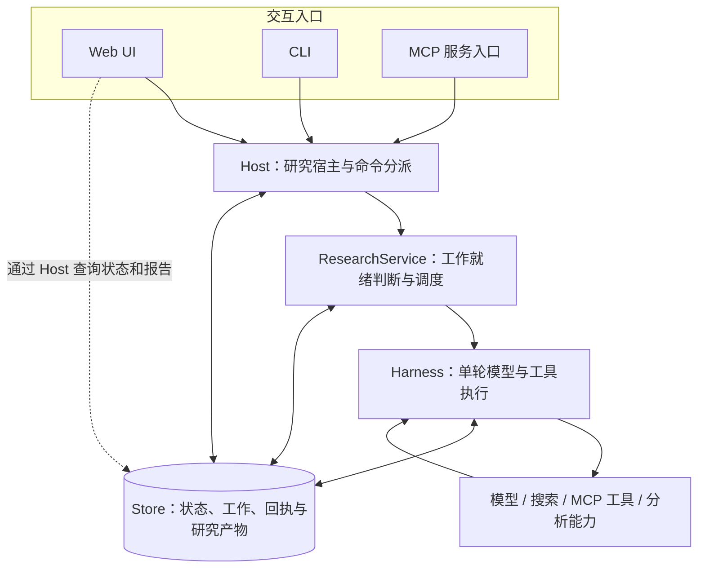
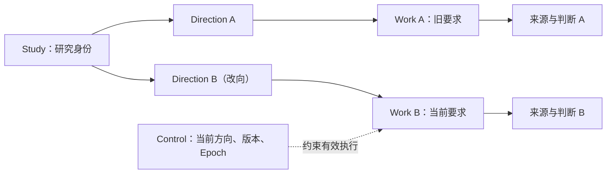
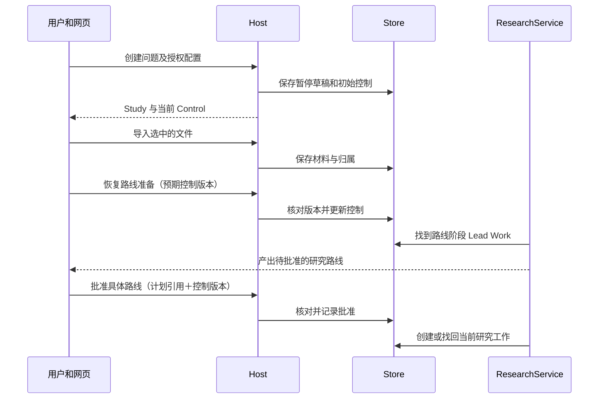
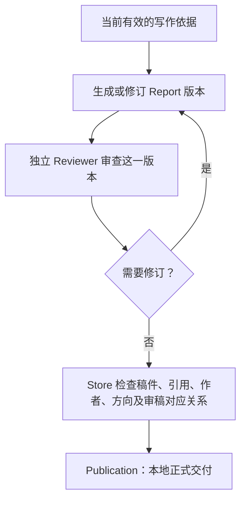

# 02 整体架构与任务流程

一项深度研究从开始到交付，可能跨越数百次模型调用、多个调查助手、若干外部资料渠道和数次用户操作。如果这些行为只靠当前页面的一串对话维持，页面关闭、请求迟到或任务暂停时，系统就很难说明“哪些事做过了、哪些工作还应该继续”。

Epivra 的架构围绕一个明确的组织方式展开：**入口负责表达用户意图，Host 维持研究宿主，ResearchService 安排能够推进的工作，Harness 完成一轮受约束的模型与工具执行，Store 保留可追溯的研究事实与状态。** 这一分工也决定了本章的阅读路线。先理解层与层之间交接什么，再沿真实的研究生命周期，观察它们如何合作。

## 02.1 从入口到执行：为什么要分成五个职责

图中最重要的关系不是由上到下调用了多少层，而是 **Store 被多个层共同使用**。创建研究需要落库，调度需要读取工作状态，执行需要写入请求和回执，展示报告也需要查询已保存的成果。Store 不是所有步骤走完后才出现的“存盘按钮”，而是贯穿研究生命周期的事实依据。

Web、CLI 和 MCP 负责三种不同的交互方式。网页提供资料导入、研究批准、进度查看与报告阅读；CLI 适合在终端完成配置和操作；MCP 服务让外部 AI 客户端通过统一协议调用 Epivra 的研究能力。**三个入口复用同一个 Host 和研究规则，而不是各自维护一套 Agent。** 外部入口的自动化流程可能与网页不同，但权限、工作状态与研究记录仍在底层汇合。

Host 在 [`host.py`](../../src/epivra/host.py) 中管理本地工作区、研究服务、连接客户端及退出清理，并通过 `dispatch` 处理命令。它相当于研究的常驻运行容器：网页标签页只是其中一个控制界面。关掉标签页不直接结束已经由 Host 管理的研究，正常退出 Host 则需要收尾运行任务与外部资源。

ResearchService 在 [`application.py`](../../src/epivra/application.py) 中决定**现在应该推进哪一份 Work**。它检查当前方向是否已发布、研究是否暂停、某份工作是否已经终结或受到阻断，以及助手结果和澄清是否改变了可运行集合。它不会把所有未完成工作无条件同时送进模型。

Harness 在 [`harness.py`](../../src/epivra/harness.py) 中回答另一个问题：**选中了这份 Work，怎样安全地执行它的一轮？** 它装配模型输入，冻结请求，读取完整响应，校验工具与参数，执行获准动作，并保存观察与回执。研究负责人、调查助手和审稿者复用这套执行机制，差异主要由任务、角色、上下文和允许的工具决定。

Store 在 [`storage.py`](../../src/epivra/storage.py) 中负责持久记录及业务不变量检查。“持久”指程序重启后能重新读取，并不意味着内存中的 Python 函数栈或所有外部连接都被保存。后续第 08 章会解释为什么恢复必须依赖业务状态和回执，而不是试图让一个中断的函数原地续跑。

### 沿一次操作区分“命令”与“工作”

以用户点击“批准研究路线”为例：这是一次**命令**，目标是改变获准的研究状态；它不是让网页直接去调用搜索模型。Host 接收命令，Store 核对当前控制版本与被批准的路线，保存有效批准。ResearchService 随后发现可以推进研究 Work，Harness 才在获准的状态下执行下一轮模型与工具调用。

因此，“批准按钮响应成功”“某个 Work 开始推进”“模型返回搜索结果”是不同层次的事件。把这些事件分开，才能准确定位错误、展示进度并处理重试。

## 02.2 研究如何有身份、有方向、有记录

持续研究需要区分四种经常被混淆的对象：**研究是谁、当前要求是什么、谁在执行哪份工作、已经留下什么成果。** Epivra 用 Study、Direction、Work 和 Artifact 表示这四类关系，Control 再独立决定当前哪些执行有效。

| 记录 | 在系统中的含义 | 典型问题 |
| --- | --- | --- |
| Study | 研究的稳定身份 | 这些记录属于哪项研究？ |
| Direction | 某次研究目标及策略的固定快照 | 当前要求与获准范围是什么？ |
| Work | 分配给负责人或助手的一份任务 | 谁负责这一部分，处于哪个阶段？ |
| Artifact | 有稳定引用的来源、观察、判断、草稿及其他产物 | 这个结果存在哪里、依据是什么？ |
| Control | 当前批准、暂停、取消、方向、控制版本与 Epoch | 某个正在返回的动作还允许影响当前研究吗？ |

假设用户最初研究“某技术架构的性能”，之后把重点调整为“安全性”。Study 仍然是同一项研究，新的 Direction 则固定新的要求；此前产生的 Work 和研究产物仍可被识别为旧方向中的成果，不能因为文字相似就自动获得新方向的执行资格。这种区分让项目支持改向，同时保留以前研究是依据什么完成的。

Artifact 在 [`domain.py`](../../src/epivra/domain.py) 中包含 `ref`、所属 `study`、`kind`、正文 `body`、上游 `parents` 和入库 `seq`。其中 `ref` 是稳定引用，不是临时展示序号；`parents` 记录所依据的既有对象，使“助手交付 → 研究判断 → 原文来源”这样的追溯成为可能；`seq` 则帮助系统确定实际进入记录的次序。第 06 章会再解释内容寻址如何使修订形成新版本，而不是悄悄覆盖旧材料。

Control 与 Artifact 的职责尤其需要区分。持久化证据告诉系统**事实依据是什么**；控制状态告诉运行时**现在还有没有资格执行**。如果用户暂停研究，一份已经取得的来源不会因此凭空消失，但正在推进的旧 Work 必须按照新的 Epoch 重新检查资格。

这个区分并非要在本章背诵数据库字段。读到任何记录，只要能说清**归属、当前性、来源关系和可执行资格**，就已经抓住了整个持久研究模型的核心。

## 02.3 一项研究为什么从“暂停的草稿”开始

网页的创建流程值得完整走一遍，因为它串起了用户操作、资料准备、模型规划和批准边界。

**第一步：创建受约束的研究草稿。** 用户提交研究问题、模型与工具选择、材料访问范围。Host 检查必要配置后保存 Study、Direction 和初始 Control，并使新研究处于暂停状态。此时已经有明确身份与授权范围，但尚未开始完整调查。

**第二步：导入最初选中的材料。** 页面拿到已经创建的 Study 后，再逐份提交文件。先创建、后导入，避免一开始的研究路线在初始材料尚未进入工作区时就被生成。文件成功导入后从当前待处理列表移除；部分文件失败时，已经成功的资料不会被当成未发生。导入成功也不表示模型已经阅读其全部正文。

**第三步：恢复路线准备。** 页面提交与当前控制版本一致的恢复操作。ResearchService 驱动路线准备阶段的 Lead Work：模型可以理解问题、利用当前允许查看的材料目录与概况，形成待用户审批的调查路线。此阶段使用的是收缩后的工具集合，不会直接进入完整搜索、来源正文读取或助手委派。

**第四步：批准这份具体路线。** 页面提交路线引用以及它读取时的 Control 版本；Store 必须确认它们仍指向有效的当前状态，才会保存批准。随后 ResearchService 才可以推进正式研究阶段。

为什么批准时必须带着当时看到的版本？因为用户打开确认窗口之后，研究要求或控制状态可能已被另一操作更改。没有版本检查，一个旧页面就可能批准已经失效的路线。这是典型的**乐观并发控制**：不要求用户在打开弹窗期间独占研究状态，而是在提交修改时核对期望版本，拒绝过期决定。

MCP 入口同样先创建暂停草稿，但外部客户端要自行安排初始资料导入和恢复操作。复用底层 Host 保证的是研究规则一致，不要求三个界面强行拥有相同的交互步骤。

## 02.4 获批之后：多份 Work 怎样变成连续研究

批准之后，ResearchService 首先读取当前 Control。若当前方向已经有正式发布记录，它会停止推进；若研究被暂停、取消或当前 Epoch 已不匹配，也不会把旧工作当作正常就绪任务。

正式研究阶段，系统有一个承担最终责任的 Lead。Lead 可以通过 Harness 自行查资料、记录判断、计算与写作，也可以创建具有独立任务和上下文的助手。ResearchService 收集未完成的子 Work，观察助手成果和澄清问题是否出现，再决定哪些工作此刻可以运行。

假设 Lead 已委派两个调查任务：一个梳理多 Agent 上下文治理，另一个寻找真实工程案例。两个助手能够分别读取材料，向自己的上下文累积观察；它们产生的完整私有对话不会默认灌入 Lead 的上下文。达到交付条件后，助手通过持久记录返回结果、来源和缺口，ResearchService 再将工作交付作为观察送回负责人。

这个过程既是协作，也是上下文工程：**任务让调查方向相对独立，Work 让模型输入局部聚焦，持久引用让最终整合能够回到证据。** Anthropic 在 [Effective context engineering for AI agents](https://www.anthropic.com/engineering/effective-context-engineering-for-ai-agents) 中将多 Agent、压缩与结构化笔记并列为长任务上下文治理方法；在 [How we built our multi-agent research system](https://www.anthropic.com/engineering/multi-agent-research-system) 中进一步说明了子 Agent 独立探索、向负责人浓缩交付的工程逻辑。Epivra 的实际权限、交接和任务状态仍以本项目代码为准。

当助手遇到需要负责人统一决定的前提时，可以提交内部澄清并等待。这里不是“隔几秒再问一下”，而是由持久的澄清记录和状态变化唤醒有关工作。负责人也不应同时等待一个正因向自己提问而阻塞的助手。第 04 章会用完整的状态推演讲清这一过程。

### 外部工具和分析结果怎样回到研究

Harness 接到模型工具请求后，要校验本轮可用工具集合、参数及角色权限，然后才进行真实调用。模型的搜索响应可能提供网页线索、摘要或原文片段；系统会将取得范围如实保存，使后续调查能够继续定位原文，而不是把“出现了一条搜索结果”当作“已完整阅读并验证来源”。

代码分析同样接入研究材料链：它在允许的分析环境中接收明确的输入来源，执行后保存日志与结果产物，并关联上游输入。这样报告中的数字能够回到哪份资料、哪段处理过程。但是否采用这项计算得出的判断，仍需要根据方法和证据条件核查。第 05、06 章分别展开工具执行和证据组织。

## 02.5 从稿件到正式报告：为什么要绑定版本

研究已经获得材料后，写作者可以形成稿件，但一段文本并不等于正式交付。Epivra 需要把“内容是什么”和“这份内容经过了怎样的核查”绑在一起。

同一份稿件可以反复改进，但每次改写后都有新的内容状态。Reviewer 要检查的必须是**准确绑定的报告及其依据**。如果它审过的是版本 A，版本 B 即使只做了局部修改，也不能直接沿用版本 A 的接受记录。程序在发布前检查当前稿件、有效写作依据、独立审稿及引用关系，避免旧判断错配到新成果。

这里的两个检查者职责不同：模型 Reviewer 关注事实忠实度、论证、限制条件与缺口；程序校验负责身份、引用、方向、版本等能够确定地判真的条件。两者组合才构成 Epivra 的交付流程。

## 02.6 页面状态为什么也需要并发控制

Agent 在后台运行，网页会周期性读取状态，因此两个层面都可能发生“旧结果后来才返回”的问题。

第一个发生在**显示层**。用户先打开研究 A，发起状态读取，随后立即切换到研究 B。如果 A 的响应比 B 的响应更晚返回，页面不能仅凭“最后到达”就把 A 的数据覆盖到 B。网页用当前 Study 与读取序号核对响应归属，只接受仍属于当前页面的最新结果。相同研究的在途读取还可复用，以减少重复请求。

当前版本的页面在一次轮询结束后约三秒安排下一次；页面隐藏或正在修改状态时跳过部分刷新。轮询负责展示研究进展，并不是让 Agent 每三秒运行一轮。后者由后台 ResearchService 调度，这两个循环不能混为一谈。

第二个发生在**命令层**。批准、暂停、导入或调整方向时，界面要携带与用户当时看到的状态一致的标识，后台再核对。这是为了防止过期页面对已经改变的研究做出过期决定，属于正确性问题，不能仅靠前端把按钮禁用解决。

此外，创建研究若遇到“后台成功创建，但返回响应丢失”，界面不能未经确认就自动重新创建一次研究；设置窗口重新打开时，也不能让上一次编辑会话的迟到结果覆盖本次配置；文件导入需要只移除实际成功的待传文件。它们都属于同一种工程思想：**异步系统必须明确请求归属、版本和确定的执行结果。**

中英文界面切换只更改注册过的界面文本，不翻译研究原文和内部协议值；CLI 退出菜单也不会天然取消后台 Study。不同入口保持各自的交互特点，但共享研究身份和控制语义。

## 02.7 从一次失败操作，理解架构的真正分工

面试官如果追问“为什么不用一个 FastAPI 请求一路 await 到研究完成”，核心不是回答“因为异步任务耗时长”，而是分清**用户请求的生命周期**与**研究工作的生命周期**。前者要求尽快确认命令是否被接受；后者可以持续查证、等待其他 Work、暂停恢复，并在退出页面后由本地 Host 继续驱动。把两者绑成一个 HTTP 请求，客户端超时后不仅无法展示可靠进度，还容易把重复请求误当成重新开始任务。

下面用两个具体场景理解这种分层。

### 场景一：用户看到旧路线，提交批准时研究方向已变化

假设界面读取到 Control 引用 `C1` 和计划 `P1`。在用户点击批准前，另一条合法操作把控制更新成 `C2`。旧界面仍将 `P1` 和期望版本 `C1` 一起提交。Host 收到指令后交给 Store 校验：当前控制引用已经是 `C2`，因此该修改因版本冲突被拒绝，而不会产生“按钮显示批准了旧路线，后台却研究新方向”的矛盾。

这里的几个机制承担不同责任。前端传入期望版本，只表达“我正在修改我当时看到的状态”；Store 的事务负责原子地**检查当前状态、验证业务前提、写入新状态和命令回执**。应用无法仅靠前端按钮锁或 Python 的进程内锁保证这一点，因为过期命令可能来自 CLI、MCP 或另一个页面。

`Store.transaction` 在 [`storage.py`](../../src/epivra/storage.py) 使用 SQLite 的 `BEGIN IMMEDIATE` 开始写事务：它会尝试提前取得写事务资格，再在同一事务中完成必要的业务检查和写入；成功后 `COMMIT`，异常时 `ROLLBACK`。提交后的通知唤醒关注这个 Study 的运行逻辑。**数据库事务负责本地状态的一致提交，不可能把远端模型调用一并纳入这个 SQLite 事务。** 这是第 08 章需要操作账本与恢复协议的根本原因。

### 场景二：两个调查助手同时取得资料，负责人只看到其中一个结果

假设子 Work A 已持久化工作结果，子 Work B 还在等待来源读取。ResearchService 下次驱动研究时会发现 A 的交付，向 Lead 保存对应的观察，让负责人知道“这份子问题已经完成”，并带着交付引用继续思考；B 依然保持未完成状态，不会被当作成功。

因此，**任务调度和结果交付必须分别建模**：Work 表示谁承担这项任务，`work_result` 表示某次可核查交付，Observation 表示另一份 Work 已得知该交付。它们不是一个内存中 `asyncio.Task` 对象的三个别名。即使重启后 `asyncio.Task` 不存在，已保存的 Work 与结果仍能被重新查到。

进一步看，一份任务可能先因外部服务错误被阻断，之后用户继续研究。ResearchService 重新判断它是否具有继续资格；Harness 再依据冻结的 step、操作状态和回执决定是否复用结果、是否必须阻断。这种分层保证**调度器不会自行假设远端调用可以重试**，远端调用的可靠性逻辑也不替调度器做全局研究决策。

这样才能真正回答“Host、ResearchService、Harness、Store 为什么不合并成一个类”：它们管理的状态寿命、并发边界和正确性责任本来不同。项目不是为了更多抽象而分层，而是把不同故障域分开，让同一份持久事实能够支撑多个入口、多个 Work、长时间运行和恢复。

## 本章小结

通过这一章，应当能从一次用户操作推导出完整运行链：**入口提交意图 → Host 分派研究命令 → Store 保存有效状态 → ResearchService 选择就绪 Work → Harness 执行真实模型与工具轮次 → Store 保存结果 → 负责人整合工作 → 版本绑定的审稿与发布。**

理解这条链之后，遇到新模块时可以沿着三件事定位它：接收什么输入、改变什么持久或临时状态、输出交给谁。下一章将把观察焦点放到 Harness 内部，解释冻结请求、模型协议适配、工具执行、并行处理和工作终止如何构成一轮可继续、可核查的 Agent Loop。

## 本章源码索引

- [Host：命令分派、研究服务与退出清理](../../src/epivra/host.py)
- [ResearchService：工作选择、结果交接与任务推进](../../src/epivra/application.py)
- [Harness：单轮执行与上下文装配](../../src/epivra/harness.py)
- [Store：事务、控制、工作和发布校验](../../src/epivra/storage.py)
- [持久记录与模型响应类型](../../src/epivra/domain.py)
- [网页接口、轮询与控制操作](../../src/epivra/webui.py)
- [CLI 操作入口](../../src/epivra/cli.py)
- [MCP 服务入口](../../src/epivra/mcp_server.py)

## 延伸阅读

- [Anthropic — Effective context engineering for AI agents](https://www.anthropic.com/engineering/effective-context-engineering-for-ai-agents)：理解为什么持久引用、局部上下文和按需回读需要共同设计。
- [Anthropic — How we built our multi-agent research system](https://www.anthropic.com/engineering/multi-agent-research-system)：理解研究类 Agent 为什么将全局协调与局部探索分开。