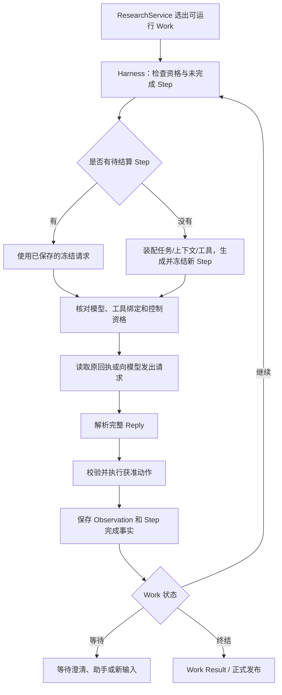
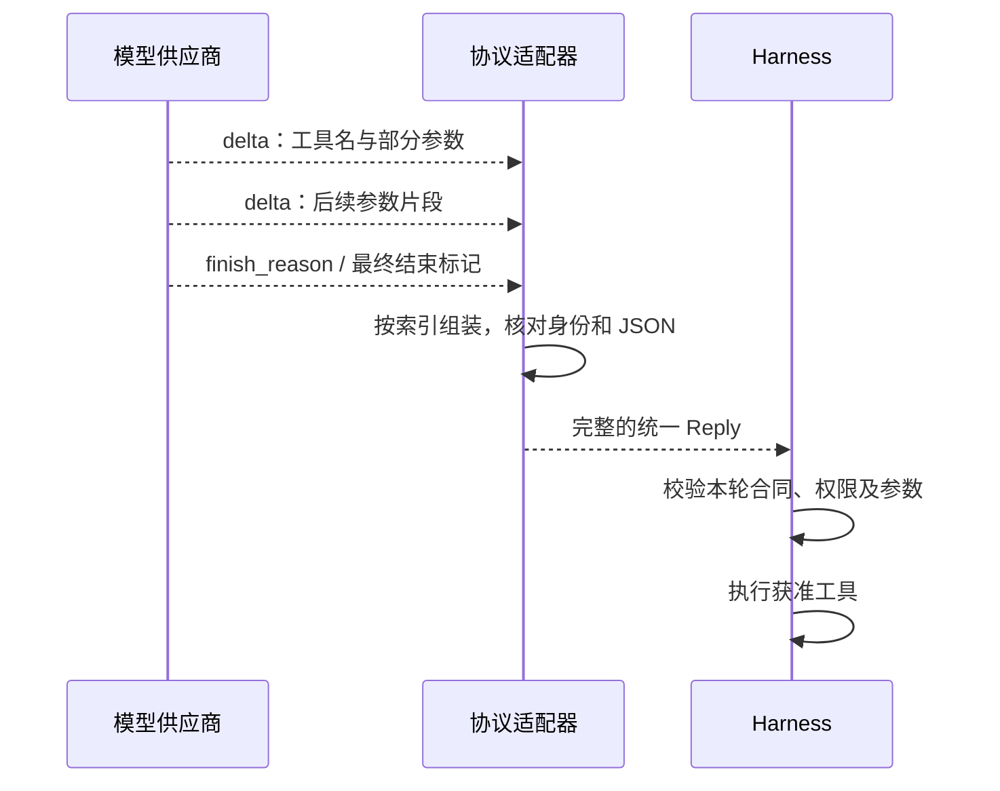
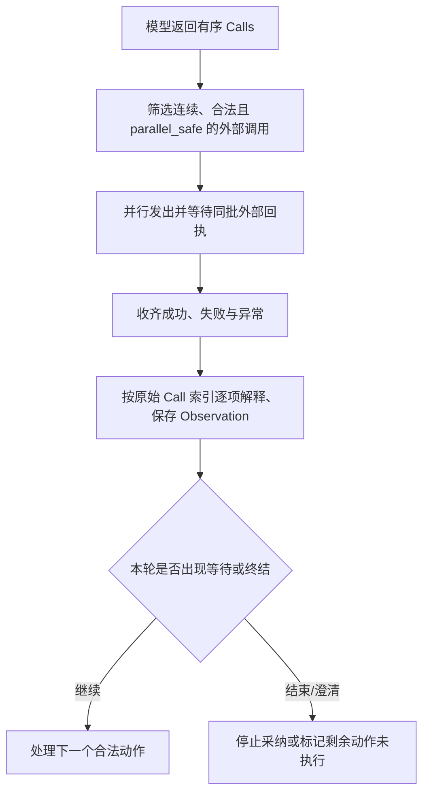
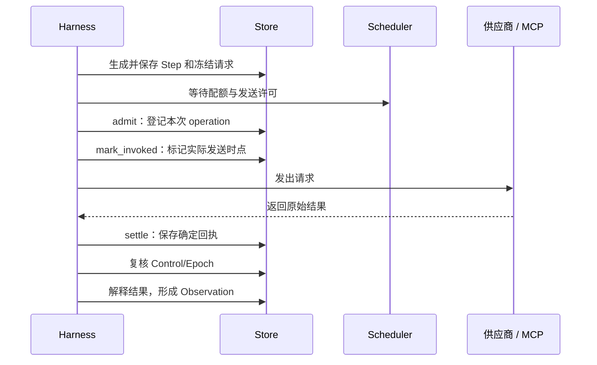

# 03 智能体运行机制

第 02 章讨论了 Epivra 如何保存研究状态、选择可以继续的 Work，并把持续研究与短暂的网页请求分开。现在把视角收窄到一个正在执行的 Work：**模型怎样提出动作，程序怎样把它变成真实行动，并且在失败、暂停与恢复时保留已经发生的事实？**

Epivra 的答案是 Harness（智能体运行框架）。无论模型正在承担 Lead、Investigator、Synthesizer、Writer 还是 Reviewer 的职责，底层都使用同一套可恢复的执行循环。角色决定任务和能力范围，模型决定当前要采取的研究动作，Harness 负责固定本轮输入、验证动作、驱动真实执行、保留回执和反馈。

这个设计可以从一次 Agent Loop 理解，但它并不是一个简单的 `while True: call_model(); call_tool()`。真正需要设计的是**模型请求、外部执行、持久记录、用户控制和下一轮判断之间的交接**。

## 03.1 一个 Work 如何经历连续的执行回合

设想研究负责人已委派 Investigator 核查一份 AI Agent 性能报告。助手首先需要查找资料，再阅读方法部分，之后可能比较实验指标、形成研究判断，最终交付给 Lead。这些动作并不能在最初一份固定脚本中完全确定，因为第一轮取得的资料会改变下一轮真正需要解决的问题。

Harness 按照以下执行循环推动这份工作：

这张图里的两个对象不能混为一谈。**Work 是持续存在的一份任务；Step 是这份任务中一次有确定输入身份的模型回合。** Work 可以包含许多 Step，也可能暂时等待内部澄清；Step 则要精确说明这一轮使用了什么模型、工具和输入，以及每个实际执行动作的结果归属。

当 ResearchService 选中 Work 时，Harness 会获取当前 Control，并用 `require_work` 确认工作仍属于有效方向、当前 Epoch，且具备执行资格。它还要查看 Work 是否已经有 `work_result`，是否有等待中的澄清，以及最后一个 Step 是否已经拥有 `step_done`。

如果发现未完成的 Step，Harness **优先继续原 Step**，而不是马上生成一个新的请求。只有当前没有待结算 Step 时，才会重新装配上下文，并创建下一轮 Step。这使得“进程重启”不等于“研究流程从头再来”。

### 为什么还需要一把异步锁

同一 Work 可能因为调度唤醒和状态变化被重复选中。如果两个执行协程同时为它创建下一轮请求，就可能让同一任务产生两条彼此争夺状态的执行链。`Harness._step` 通过每个 Work 对应的 `asyncio.Lock`，确保**同一进程内，同一 Work 的推进一次只由一个协程进入关键区**。

但这个锁既不是数据库事务，也不是用户暂停的总开关。用户通过 Host 发出的 Control 命令不会为了等待模型回合结束而去争这把锁；Control 可以产生新的 Epoch，后续执行资格检查会阻止旧回合继续提交当前研究成果。Python 官方文档也明确指出 `asyncio.Lock` 用于异步任务间的互斥，不能被当作跨线程或跨进程锁使用。

## 03.2 本轮上下文怎样变成一份冻结的模型请求

模型并不是直接读取整个 Study 数据库。Harness 的 `_request` 为当前 Work 组合本轮必需的信息：研究目标、获准路线、角色与当前任务、可使用的研究记录、已交接来源、工作记忆、最新观察、待接收消息和本轮工具 Schema。

这份输入有两方面的要求。**完整性**要求模型看得到完成当前职责不可缺少的约束和证据引用；**相关性**要求长研究的所有原文、历史工具输出和其他助手私有对话不能无条件塞满当前窗口。Epivra 使用按任务聚焦的材料、分页回读和工作记忆解决这一问题；上下文预算、清理与压缩检查点的具体实现由第 04 章负责深入解释。

在发送前，模型适配器还要把内部统一请求转换成供应商能够接受的协议结构。例如 Chat Completions 的 `messages` 和 `tools`、Anthropic Messages 的内容块结构，并非可以直接互换的 JSON。项目先生成正确的供应商请求，再把它与本轮工具合同和模型身份一起保存为 Step 的请求快照，供下一次恢复时核对。

这里有一个常见的架构追问：**既然 Store 已经保存了历史消息，为什么还要冻结每一轮请求？**

因为“现在重新装配一个相似上下文”与“恢复此前真正准备发送的请求”并不等价。研究可能新增消息，默认模型可能变化，某个 MCP 工具的定义也可能更新；重新装配出来的 Prompt 已不是原来那一次调用。冻结请求把**本轮选择的模型、实际输入、工具 Schema 与执行合同**固定下来，使后续回执可以归属于准确的请求身份。

如果恢复时当前模型 `identity` 与原请求不一致，或外部工具的 `binding`、允许工具的 Schema 发生变化，Harness 会拒绝把原 Step 放进新环境里“按差不多的条件继续”。拒绝旧合同下的执行，是为了避免某一次本已获准的动作在不知不觉间改变了能力和含义。

模型请求也不会把 API Key 写进模型正文。冻结的是调用内容和身份合同，通信层实际发送时再附加认证凭据。**可恢复的请求快照与敏感凭据是两种不同的数据**。

## 03.3 模型适配：统一回复结构，同时尊重原生协议

一项研究可以为 Lead 和助手配置不同供应商的模型，但不能为每种模型分别复制一套 Agent Loop。Epivra 用 `Model.complete`、协议适配器和统一 `Reply` 将二者分离。

内部 Reply 只保留 Harness 真正需要的三项内容：

| 字段 | 在执行循环中的意义 |
| --- | --- |
| `text` | 本轮模型返回的可见文字 |
| `calls` | 有顺序的工具调用，每项包含名称与参数对象 |
| `complete` | 当前模型回复是否按协议完整结束 |

特别要理解：**`complete=True` 只意味着这一份模型回复可以被处理，不表示该 Work 结束，更不意味着研究已经发布。**

不同模型协议的返回格式由适配器收敛：

- Chat Completions 路径解析 `choices`、`message`、工具调用和 `finish_reason`，并检查工具调用身份与参数 JSON。
- Anthropic Messages 路径解析 `text` 与 `tool_use` 等内容块，根据 `stop_reason` 判断结束方式，还要在协议层保存正确续接所需的原生结构。
- Gemini 路径处理其内容块、函数声明与模型响应结构，交回相同的 Reply 合同。

三者统一的是**模型向 Harness 表达建议的接口**，并不意味着供应商的隐藏思考块、签名、特殊结束原因或续接约束全都相同。原生协议的数据在适配器层合法保留；上下文摘要和研究笔记只能使用允许公开的内容，不能把隐藏推理或签名当作已经公开的研究事实。

### 模型配置为什么必须同时包含容量和能力

模型目录提供维护过的供应商与型号预设；账户模型发现从已验证的官方接口返回可见型号。账户“看得到型号”并不等于该型号的工具调用或流式协议都通过了 Epivra 兼容性验证。

`model_settings` 核查输出 Token 额度必须是正整数、总上下文容量必须大于输出额度、已知预设不能超出文档限制，并将区域解析到目录中的官方连接地址。非预设模型需要明确容量设置；流式模型请求也受到已验证预设能力的约束。创建研究时固定这些配置，避免后续本地默认值改变当前 Study 的执行合同。

还应区分三种资源：

**上下文容量**决定一轮模型请求能容纳多少输入与预留输出；**单轮输出额度**控制本轮最多生成多少；**供应商请求数/Token 速率额度**控制一段时间内允许发出多少调用。前两项决定本轮能否构造合法请求，第三项决定何时有资格发送。第 04 章会把它们与 Agent 运行名额关联起来。

## 03.4 流式与不完整响应：什么时候绝对不能执行工具

流式返回会将正文与函数参数分割成多条事件。某个片段可能只包含 `{"ref":` 的开头，还不足以构成合法的参数 JSON。即使后续片段能解析，程序也需要知道当前工具调用身份、顺序和整份回复的结束原因没有异常。

在 Chat Completions 的流式路径中，`_ChatStream` 按工具序号累积工具名、参数片段和调用 ID，并检查是否缺少中间序号、ID 是否被中途替换、是否收到结束原因。底层 SSE（Server-Sent Events，服务器发送事件）还需要完整的结束标记；连接提前断开、事件结构异常或超出规定字节容量，都不能被当成正常完整的回复。

这里必须区分两种失败，因为它们对应的恢复动作完全不同。

**情况一：模型返回了已结算的响应，但协议表明内容不完整。** 比如合法的 Chat Completions 响应以长度限制结束，统一 Reply 的 `complete` 为 `False`。Harness 已经拥有这次模型调用的确定回执，会保存协议错误对应的 Observation，将该 Step 记为结束，然后在后续新回合要求模型缩短输出或拆分动作。**已经收到完整外部回执，不代表回执中的模型动作有效**；不完整 Reply 的全部工具都不得执行。

**情况二：连接在完成之前中断，连确定的模型响应回执都没有。** 比如 SSE 流提前关闭。这时本地不能假设供应商没有生成或计费；原操作会保留结果未知的恢复语义，而不能把它等同于“收到 `complete=False`，已经安全完成这一轮”。程序需要按原操作身份和恢复条件核对，不能悄悄创建新 Step 将相同付费请求再发送一遍。

Anthropic 的官方流式工具调用文档也明确指出，参数可能以局部 JSON 片段到达，尤其在细粒度工具流中，不能假设片段本身可解析。Epivra 的设计要点是**先确认整个模型回复的执行资格，再允许其中任何动作产生真实副作用**。

## 03.5 工具建议如何经过程序授权，真正进入执行

OpenAI 的 Function Calling 与 Anthropic 的 Client Tools 都强调：模型返回工具请求，应用负责执行，再把实际结果返回给模型。Epivra 在这个基本调用合同上，还增加了研究授权、角色、持久回执和恢复检查。<escape> </escape>

模型在一轮 Reply 中输出例如 `web_search(query="...")`，只是**建议使用这项能力**。Harness 会先从保存的本轮工具清单中核对工具名，再用参数 Schema 和工具自身的校验器检查参数、引用及供应商前提。内建能力由 Harness 与相关研究组件执行；外部 Tool 则经可记录操作身份的调用路径连接网络或 MCP 服务。

可用工具不是提示词里的一张永远不变的名单。`Harness._schema` 根据当前 Work 的角色、研究策略、审批状态和审稿模式形成不同工具集合。正式研究路线获批之前，Lead 可以读取获准材料的目录与概况、维护工作记忆并通过 `propose_plan` 保存路线，但不能借此提前开展完整联网取证、读取 Source 正文或委派助手。

获批之后也不是所有工具无条件开放。网络能力依赖研究策略，`run_analysis` 需要独立启用，MCP 工具还受安装时冻结的授权与角色许可约束。即使某个 Investigator 在模型输出里写出 `delegate_work`，也不会因此获得 Lead 才有的委派权限；Store 在实际创建 Work 时仍核对真实负责人身份。

**工具可见性和执行前校验是两层互补的防线。** 第一层让模型知道当前可以做什么；第二层确保即使它猜错工具名、生成非法参数或引用过期状态，也不会凭一句模型文字改变用户授权。Schema 检查通过仍不证明来源可靠，也不能替代后续的证据审查。

执行后，Harness 将实际结果保存为 Observation。它可能包含来源引用、计算产物、网页搜索线索，也可能是清楚的执行错误。来源“已取得”与结论“已被证实”还需要第 05、06 章的工具与证据机制去区分。本章最重要的是**模型建议 → 运行时检查 → 真实执行 → 持久 Observation → 下一轮模型判断**的闭环。

## 03.6 一次回复有多个工具调用，怎样管理并行与顺序

模型可以一次提议读取两份互不依赖的外部资料，这类请求有机会并行减少等待。但如果它先搜索某篇报告，再打算读取“刚才搜索返回的 Source 引用”，后一项所需的真实引用在模型作出前一项建议时并不存在，就必须等待前一轮实际 Observation。

Epivra 的 `Tool.parallel_safe` 显式声明外部能力是否允许纳入同批并行取得。Harness 不把所有动作一股脑提交给 `asyncio.gather`，而是从当前动作开始，寻找一段**连续、可见、参数有效且声明并行安全**的外部调用；批次规模受 Scheduler 允许的容量限制。

一个很有价值的源码细节是：**并行的是外部请求的取得，按顺序发生的是模型动作的采纳**。Harness 会先通过 `_external` 发出这个安全批次；即使某项操作失败，也要等待已经接纳的其他操作结算，不能丢下已发送的请求不管。随后才按模型原始动作索引解释返回、形成 Observation、进行进一步证据处理。

为什么不直接对整个 Reply 完全并发？因为不同动作之间可能有真实的数据依赖，也可能修改相同的共享状态。为什么不全部串行？因为相互独立的网络读取不需要互相等待。Epivra 将并行范围收敛到经过声明的外部工具，避免在不了解副作用的情况下并发执行全部内建动作。

**并行安全声明是工具合同，不是对模型提议的全部业务依赖进行形式化证明。** 研究中的因果判断仍要由模型与程序共同承担：模型不能在尚未取得搜索结果时捏造来源 ID，程序也不能仅凭工具都叫“搜索”就推断全部远端操作绝对无副作用。

在同轮执行中，如果助手成功调用 `request_clarification` 并进入等待，Harness 会为后续尚未执行的调用写入 `not_executed` 对应的观察，让下一轮在收到澄清答复以后重新考虑；如果 Work 已经产生 `work_result`，本轮也不继续正常采纳其他动作。这使得**等待与终结改变执行合法性**，不仅仅改变界面状态。

## 03.7 成功保存一轮，不等于 Work 或 Study 已经完成

当模型只返回一段正文、没有工具调用时，Harness 可以保存这段文本，但会提示它使用合法的结果动作。因为模型说“调查结束了”不等于工作真的提交了交付记录。

Epivra 为不同工作使用明确的终结合同：

| 角色与阶段 | 正式动作 | 为什么需要它 |
| --- | --- | --- |
| 规划阶段的 Lead | `propose_plan` | 保存待批准 Plan，并为路线 Work 生成终结记录 |
| Investigator / Synthesizer | `finish_work` | 返回局部结论、证据引用和未解问题 |
| Writer | 保存稿件后 `finish_work` | 明确交回最新有效 Report，结束写作责任 |
| Reviewer 的局部核查 | `finish_work` | 交付特定范围的问题检查结果，不替代最终审稿 |
| Reviewer 的整稿终审 | `submit_review` | 形成准确绑定报告版本的 Review |
| Lead 的最终交付 | `publish_report` | 经 Store 校验后产生 Publication 和终结结果 |

从源码看，`Harness.finished` 通过属于该 Work 的 `work_result` 判断它是否已终结。取消同样会形成相应的终结结果，所以“已经结束”和“成功完成委派目标”还需要结合结果内容判断。

要形成正式报告，Lead 会持续检查每个研究问题的证据覆盖情况。`assess_questions` 等动作帮助它保存研究问题的具体判断，其中 `continue`、`ready`、`limited` 表达继续调查、准备写作或只能带限制回答的判断；它们并非运行时根据工具调用次数自动计算的完成率。

Writer 调用 `draft_report` 或 `patch_draft` 保存当前稿件和 `draft_saved` 回执，并不自动结束 Writer 的 Work；只有 `finish_work` 交回符合合同的当前报告引用，才能完成这次写作交接。独立 Reviewer 的接受结论则必须绑定具体版本，完整报告还要真正进入审稿模型的输入。最终由 Store 检查当前方向、写作资格、引用关系和报告/审稿对应性，再产生本地 Publication。

这里体现了三个递进层次：**Reply 完整只说明本轮模型响应可被处理；Step 完成说明本轮动作已经结算；Work 终结和 Study 发布则要满足各自的业务合同。** 即使最后一个模型回合非常流畅，也不能绕过后两个层次。

## 03.8 一次模型或外部调用怎样保存、重放并避免盲目重试

长任务会遇到一个传统短请求不容易说清的故障：**请求可能已被服务商执行，客户端却没有拿到返回结果**。网络连接断开、宿主退出或超时，都不能仅凭本地异常推断远端没有计费或没有产生副作用。

Epivra 用稳定的操作身份和持久化 `operations` 账本管理模型与外部 Tool 调用。模型操作用当前 Work 和 Step 派生身份；外部工具操作用 Step 和 Call 的位置派生身份。两者虽然最终都能产生反馈，但它们**不是同一次远端请求**，应有不同的回执与状态归属。

调用过程大致是：

这条序列解释了为什么要在程序真正解释模型结果之前，先保存外部响应的原始回执：如果下游解析失败、用户改向或进程中断，实际发生的调用事实依然可以核查，不必为了恢复研究而重新购买一次结果。

`Store.admit` 会先检查操作身份和冻结请求。如果原操作已结算，返回既有回执；如果原操作仍为 `unknown`，则阻断把它当作一项从未发生的新调用。一个确定保存的成功回执能够被**重放（Replay）**，即不再向供应商发送请求；只有失败事实与提供方合同明确支持时，才进入真正的**重试（Retry）**。

不能把这两种机制混为一谈。一次外部工具写入结果未知时，新建一个 Work 或更换 API Key 再发相同动作，并不能让原来的副作用消失。系统宁可让该工作停在明确的恢复边界，也不把“自动重试”变成潜在的重复提交。

### 用户暂停时，已发出的请求怎么办

假设 Investigator 的 `web_search` 已获准发出，此时用户将 Study 暂停。新的 Control 会改变 Epoch，使旧 Work 不再具有对当前研究继续行动的资格。若供应商稍后返回，Harness 先尽可能结算实际外部回执，再进行执行资格检查。保存“这次调用确实返回了什么”与允许“把它采纳为当前有效研究结论”是两个不同操作。

同一 Work 的 `asyncio.Lock` 只协调本进程内的重复回合，Store 的事务保证本地提交，Epoch 隔离旧资格，操作账本负责外部请求与回执。它们有不同作用，不能以“我用了锁”代替恢复设计。

### 为什么连续失败会要求改变方法

无限尝试并不等于自主研究。Epivra 的 `_check_repeated` 检查最近三个 `step_done` 的失败签名，并比较当时的控制 Epoch、研究进展序号与工作消息水位线。只有同类失败不断出现，而且没有新来源、新结果或新消息改变条件时，才抛出 `RepeatedFailure`，要求先改变输入或方法再继续。

这个“最近三轮”是故障检测窗口，不是 Agent 总步数上限。它防止系统在资料和条件毫无改变时原地空转，与 Lead 在研究层决定是否继续寻找真实证据并不是同一个机制。运行时还会对符合条件的外部操作实行有限的恢复次数和冷却约束；它们控制的是某次操作的重试，不是整项 Study 的总研究预算。

## 03.9 把执行机制用于解释四种不同故障

为了把以上机制用于面试，可以沿同一份 Investigator Work 观察四种故障，但要注意每种情形发生在不同的层。

**场景一：模型正常返回了截断的工具参数。** 适配器已经有一份确定回执，但 `finish_reason` 指向长度限制，`complete=False`。Harness 不执行本轮任何工具，将不完整回复记录为协议问题，让后续回合缩小动作。这里首先保护的是模型回复的完整性。

**场景二：流式模型请求在 HTTP 传输中断开。** 底层没有拿到确定的模型回执，供应商可能已经产生费用。此时应保留原模型操作的未知状态，恢复时核对原身份、回执与提供方合同；不能简单当成场景一，直接发起新的 Step。

**场景三：已经取得两份互不依赖的外部资料，其中一项解码失败。** 假设同一 Reply 包含两个 `parallel_safe` 的搜索请求，Harness 已并行发出并保存各自原始结果。之后解释第一份成功、第二份失败，必须在相应 Call 索引留下准确的 Observation；已经完成的调用不因为另一项出错就被遗忘。这里重点是并行执行的回执与有序采纳。

**场景四：工具请求已发出，但用户修改研究方向。** 旧工具响应可能迟到。程序保存能够确认的调用事实，并按新 Control/Epoch 检查旧 Work，不把迟到回包直接写成当前方向的有效判断。这里重点是用户控制与外部副作用之间的故障边界。

把这些问题连起来，可以理解 Epivra 的 Harness 为什么不能简化成一个通用函数调用装饰器：**模型协议保证提议完整可解码，工具合同限制允许执行什么，持久操作身份说明实际调用发生过什么，研究控制决定当前工作还能采纳什么。**

如果要进一步比较高层 Agent 设计，Epivra 可以看作“用户审批的整体研究路线 + 根据真实观察动态决策的 Agent Loop”。这结合了先明确任务边界和执行中自主探索的能力。它没有把搜索、阅读、核查、写作硬编码成固定次数；在约束范围内，Lead 可以根据研究缺口继续选择行动。Anthropic 的 [Building effective agents](https://www.anthropic.com/engineering/building-effective-agents) 将动态工具反馈与由代码预定路线的 Workflow 区分开，可用于理解这一控制权设计。

## 本章小结

本章从一个 Work 的真实执行回合出发，解释了：**任务与工具怎样进入冻结请求，统一 Reply 怎样表达模型建议，完整性与权限如何决定动作能否执行，并行外部调用怎样形成有序 Observation，结果工具怎样结束 Work，以及持久操作回执和 Epoch 怎样使长任务可以受控接续。**

读到这里，应该能够从一个具体的失败症状追问到底：问题发生在模型协议、工具参数、研究授权、资源发送、远端执行、结果解释、工作终结，还是恢复资格。Harness 的工程价值不只是让 Agent 可以调用工具，而是让**模型的自主行动进入一套能够核查、交接和恢复的运行协议**。

第 04 章再以多份 Work 为观察范围，解释独立上下文、任务委派、澄清和联合调度；第 05、08 章分别深入工具生命周期及外部操作可靠性。本章不在这些领域重新重复全部实现。

## 本章源码索引

- [Harness：Step 生命周期、模型操作、Call 并行批次及 Observation](../../src/epivra/harness.py)
- [统一领域结构：Reply、Call、Control](../../src/epivra/domain.py)
- [Store：Step/Observation、持久 operations、控制与 Work 校验](../../src/epivra/storage.py)
- [ResearchService：Work 选择、Agent Attempt 与停止条件](../../src/epivra/application.py)
- [模型创建、模型设置验证与冻结](../../src/epivra/models.py)
- [供应商预设与官方连接地址](../../src/epivra/model_catalog.py)
- [已验证的账户模型发现](../../src/epivra/model_discovery.py)
- [Chat Completions 适配、SSE 与工具片段拼接](../../src/epivra/adapters.py)
- [Anthropic Messages / Gemini 适配及原生续接](../../src/epivra/native_models.py)
- [失败事实诊断与安全恢复条件](../../src/epivra/recovery.py)
- [Scheduler：请求额度、配额与重试时机](../../src/epivra/scheduling.py)

## 延伸阅读

- [Anthropic — Building effective agents](https://www.anthropic.com/engineering/building-effective-agents)：动态 Agent Loop 与固定 Workflow 的控制权区别。
- [OpenAI — Function calling](https://developers.openai.com/api/docs/guides/function-calling)：模型提出结构化工具调用与应用执行之间的接口合同。
- [Anthropic — How tool use works](https://platform.claude.com/docs/en/agents-and-tools/tool-use/how-tool-use-works)：Client Tool 的请求、执行与实际结果反馈。
- [Anthropic — Streaming messages](https://platform.claude.com/docs/en/build-with-claude/streaming)：流式返回中的工具参数分片、消息结束与协议完整性。
- [Python — asyncio synchronization primitives](https://docs.python.org/3/library/asyncio-sync.html)：异步互斥锁的执行范围。
