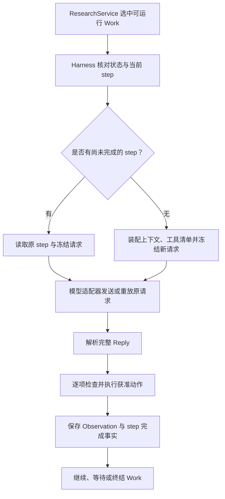
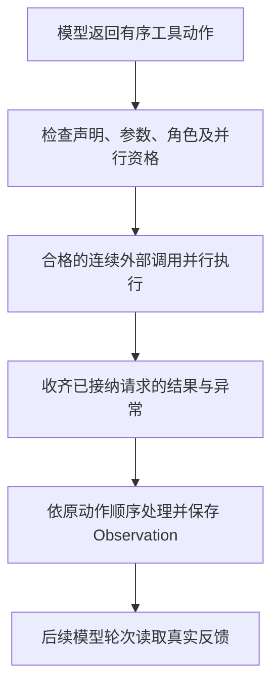

# 03 智能体运行机制

在第二章中，ResearchService 负责选出此刻可以推进的 Work。接下来需要解释一件更核心的事：**模型返回的是建议，Epivra 怎样让建议成为真实、受控、可追溯的研究行动？**

关键是 Harness（智能体运行框架）。它不是某一种研究角色专属的脚本，而是负责人、调查助手、写作者和审稿者共同使用的执行机制。不同工作依靠角色、任务、上下文和工具权限形成差异；同一个 Harness 保证它们遵循一致的模型请求、工具执行和结果保存规则。

## 03.1 一轮 Agent Loop 如何发生

Epivra 将一份持续工作的记录称为 Work，把推进一次模型请求与相应动作处理的单位称为 step。一个 Work 可以有多个 step，也可以在中途等待助手、等待内部澄清或外部服务。

这里最重要的不是箭头数量，而是**同一个 step 的请求必须有稳定身份**。如果模型响应尚未结算就遇到进程退出，恢复时应先查看原 step 与原操作账本，而不是换一个新 step 重新问模型。否则模型可能对同一问题生成不同动作，外部请求也可能重复发生。

Harness 开始执行时会检查 Work 是否已结束、是否存在未答澄清或中断，以及 Control 中的 Epoch 是否仍有效。同一份 Work 有进程内异步锁，避免两个执行回合同时修改它的状态。锁保护的是该 Work 的同一时刻执行顺序；用户暂停等控制命令仍可更新 Control，使正在执行的回合在后续检查处失去旧资格。

### 一轮真正使用的输入，不是整个研究数据库

Harness 为选中的 Work 构造本轮上下文。它包含任务、研究方向、角色、已批准路线、当前工作记忆、必要的原始资料引用、相关观察、待处理消息和可用工具说明。调查助手的默认材料还会按委派输入聚焦，不直接复制负责人的全部历史。

这正是上下文工程要解决的问题：**在有限模型输入中提供推进当前任务所必需的信息**。Anthropic 的 [Effective context engineering for AI agents](https://www.anthropic.com/engineering/effective-context-engineering-for-ai-agents) 强调每次模型调用都要选择高信号上下文，而不是把所有历史无条件追加。Epivra 用聚焦输入、引用回读和工作记忆来实现项目中的这条原则；本章先解释它怎样进入执行循环，第 04 章再系统展开上下文预算与压缩。

## 03.2 冻结请求：让恢复有可核对的起点

假设某个调查助手准备调用模型读取两份来源，程序发出了请求，随后电脑异常退出。重启后，要判断是否可以继续，至少需要知道：原来发给哪一个模型？输入的任务与资料版本是什么？允许使用哪些工具？模型是否已经返回过完整结果？

因此，Epivra 不是只保存“这一步正在运行”，而是在请求发出前固定实际请求合同。内部统一输入先经过模型适配器转换成供应商需要的格式，再持久化为该 step 的请求。恢复时可以核对原模型身份、工具绑定和 Schema，避免默认模型或工具定义变化后，旧任务被悄悄套用新环境。

这和普通聊天的“保存历史消息”不同：历史消息只是文本与交互痕迹，**冻结请求让某一次远程操作具有确定的输入身份**，回执才能准确归属原操作。模型调用本身与外部工具调用分别留下实际回执，第 08 章会完整讲解它们的持久化账本。

一个冻结请求中虽然有工具 Schema 和角色约束，却不需要复制 API Key 到模型正文。连接层在实际发送时再附加认证凭据，这样可恢复的请求数据与服务密钥保持分离。

## 03.3 从统一 Reply 到真实工具结果

模型提供工具调用能力时，通常返回工具名称与参数；真正执行依赖应用程序调用对应的处理代码。OpenAI 的 [Function calling 官方指南](https://developers.openai.com/api/docs/guides/function-calling) 与 Anthropic 的 [Tool use 文档](https://platform.claude.com/docs/en/agents-and-tools/tool-use/overview) 都强调模型生成工具请求与应用侧执行工具是不同步骤。

Epivra 将不同协议的模型响应整理为统一的 `Reply`：可见文本、`calls` 工具请求列表以及 `complete` 完整性标记。这个设计让 Harness 无须为每家供应商重新实现研究循环。

`complete` 的意义十分具体：**它说明当前模型响应是否完整，不表示整个 Work 或整项研究已经完成。** 例如模型因输出容量耗尽，只返回了一半 JSON 参数。此时即使前面有一项工具看起来可以解析，Harness 也不会在整份响应不完整的情况下贸然执行它；系统先保存错误，让下一轮改用更短、更可执行的动作请求。

当 Reply 完整时，每项工具调用仍需要经过几道验证：

| 检查 | 解决的实际问题 |
| --- | --- |
| 工具在本轮允许清单中 | 模型不能仅凭输出一个工具名获取新能力 |
| 参数满足 Schema | 阻止缺少必要参数、类型错误等不合法调用 |
| 引用与业务前提有效 | 确保被读取或修改的是实际存在、归属正确的对象 |
| 研究状态与角色允许 | 当前审批、暂停、方向和工作权限必须仍然有效 |

这说明为什么 Prompt 中的“不要越权”不能替代程序检查。模型仍负责在允许范围内判断下一步研究动作，**运行时负责落实可执行边界**。工具参数通过结构校验也不代表来源可信或研究结论一定成立，后者由后续取证、判断与审稿处理。

动作获准执行后，真实结果会进入 Observation（观察记录）。它可以是 `web_search` 返回的线索或原文、`read_source` 返回的指定范围资料、`calculate` 的算术结果，也可以是调用错误。Harness 把这些可见事实交给后续模型回合，使 Agent 能根据真实反馈调整方法，而非重复自己的推断。

例如：第一次搜索得到论文摘要，下一步通过来源引用读取真正的实验条件；如果原文与摘要中的结论不同，Agent 能修正判断。**工具调用的价值不止于获得信息，还在于让推理接受外部事实的检验。**

## 03.4 研究审批怎样转化为工具执行权限

Epivra 的 Human-in-the-loop 审批不是界面上的一句提示，而是改变工具可用范围的执行条件。

在路线准备阶段，Lead 可以理解用户输入、查看授权材料的目录与概况、维护工作记忆并通过 `propose_plan` 提交待批准路线；但它不能借这个阶段启动完整联网研究、读取来源正文、委派调查助手或编写正式稿件。用户批准具体路线后，系统进入正式研究阶段，Harness 才按当前策略和角色组装更广的能力集合。

源码中的 `Harness._schema` 根据当前 Work 的角色、研究策略、批准状态和审查模式生成工具清单。即使研究已经批准，Python 分析还需要单独启用，MCP 外部工具仍需拥有对应角色许可，联网能力也受到研究策略约束。

这构成两层相互配合的控制：

**模型可见工具集合**先减少不应出现的动作；**实际执行时的再次校验**再防止模型幻觉工具名、过期模型输出或不合法参数影响真实系统。

例如，调查助手即使在回复中写出 `delegate_work`，也不会因此获得创建下级 Agent 的权限；存储层还会检查真实委派者是否为当前 Lead。角色权限不是提示词中的身份扮演，而是持久任务身份、运行时工具清单和存储层业务规则的联合约束。

## 03.5 多模型接入：统一循环，不抹平协议差异

Epivra 支持不同模型供应商，研究创建时会固定模型配置，包括供应商、型号、协议、区域、输入输出容量和相关选项。模型目录帮助用户选择已维护的官方预设，账户型号发现则通过经过验证的只读接口获取实际可见型号。列表中有一个模型，并不自动代表工具调用、流式输出及容量组合都已完成兼容性验证。

这里至少有三种不同的容量概念：模型上下文窗口约束**本轮输入加输出可以容纳多少内容**，单次输出额度约束**本轮最多生成多少**，供应商账户配额则控制**一段时间的请求或 Token 用量**。把它们混在一起，就无法解释为什么研究可能先触发上下文容量问题，也可能先遇到 RPM/TPM 限流。

项目中的模型适配器负责转换输入输出，当前包括以下协议路径：

| 协议路径 | Epivra 重点处理的差异 |
| --- | --- |
| Chat Completions | 消息、Function Calling、工具调用片段及已验证型号的流式拼接 |
| Anthropic Messages | 原生消息与工具内容块、合法的协议续接结构 |
| Gemini | 系统说明、内容块与函数声明之间的映射 |

通过这些适配器，Harness 只需要读取统一 Reply，并按一套权限、工具和持久化规则执行。不过，供应商的原生内容块、必要签名及连续对话信息仍由协议层保留；不能为了方便研究摘要而把服务商的隐藏思考或签名转写成可见工作记忆。

### 流式响应为什么必须等结束后再解释

流式接口会把模型正文和函数调用参数拆成多段返回。单独一段可能只有参数 JSON 的一个片段，还无法确定整个工具请求是否有效。Epivra 的 `_ChatStream` 按工具位置累积名称、参数和身份，并检查最终结束标识及其原因。

只有完整拼接并验证后，才转换成普通 Reply；工具序号丢失、调用身份异常变化或连接提前结束，都不能被当作一份完整可执行的工具请求。这样既避免执行半截参数，也让“外部服务可能已经生成或收费、但本地没有完整回执”的不确定性得到明确处理。

## 03.6 一次返回多个动作时，怎样兼顾并行和依赖

Agent 可以在一次响应中提出多个动作。例如，它可能同时请求两份已经明确来源的资料；如果两份读取互不依赖，就有机会并行降低等待时间。但是“先搜索再读取刚发现的地址”有真实数据依赖，后一个动作不能在搜索结果返回之前凭空得到来源引用。

因此，Epivra 没有将全部工具调用统一丢进并发池，而是为外部工具声明 `parallel_safe`，由 Harness 收集**连续、合法、允许并行**的外部动作，在容量限制内发出。同一批已经接纳的调用会被收集完成，结果再按模型原来的动作位置处理。

这里包含两个不同层次的顺序：**获取**可以并行，**采纳与后续状态处理**仍按原位置有序进行。若同批一个请求失败，其他已经发出的操作不会因为它立即被忽略；成功回执可以保存，以便后续核查和恢复。

对于需要真实返回值才能构造下一步参数的操作，应让模型在下一轮根据 Observation 再决定。某个助手在当前轮提交阻塞性澄清后，其余尚未执行的动作也不能继续按未确定的前提执行；结束 Work 的动作则会改变后续动作是否仍有执行意义。

注意这个并行调度处理的是**一次 Reply 内的工具动作**。多个 Work 的运行并发、多个研究之间的公平名额及供应商 RPM/TPM 限制是另一层问题，将在第 04 章中介绍。

## 03.7 工作怎样真正结束，研究怎样最终交付

Epivra 不靠模型正文中的“已完成”判定 Work 终态，而要求不同职责通过相应的结果动作完成协议交付。

| 工作 | 结束或交付动作 | 完成的含义 |
| --- | --- | --- |
| 路线准备 | `propose_plan` | 保存待用户批准的路线 |
| 调查 / 核实助手 | `finish_work` | 将结论、引用和剩余缺口交给 Lead |
| 写作助手 | `finish_work` | 交还最新的正式稿并结束写作 Work |
| 独立审稿 | `submit_review` | 针对准确的稿件版本提交审查结果 |
| 研究负责人 | `publish_report` | 经程序条件校验后完成本地发布 |

对负责人而言，研究是否可以结束还需要依据**当前掌握的证据是否足以回答用户问题**。项目区分 `continue`（仍有值得推进的研究工作）、`ready`（可以进入写作）与 `limited`（只能在明确边界下作答）。这三种结果不是“查了几次就够了”的计数规则，而是面向目标和证据缺口的研究决策。

写作助手即使调用 `draft_report` 或 `patch_draft` 保存了报告版本，也不等于正式交回写作权；审稿助手的接受结果也必须绑定准确的稿件和写作依据。交付是在明确的记录关系上完成的：**研究判断 → 具体报告 → 版本对应的独立审稿 → 程序发布校验 → publication**。

## 03.8 中断与重复失败：为什么 Agent Loop 能可靠接续

持续运行的 Agent 必须面对一种普通问答没有的情况：模型请求或工具请求已经发出，本地却在响应返回前中断了。

Epivra 为外部操作留下稳定身份和持久化账本：如果完整回执已经保存，后续可以读取原结果继续；如果操作已获准发送但尚无可确认结果，则保留 `unknown` 状态，不会仅因为本地没收到回包就假定远端从未执行。

**重放（Replay）与重试（Retry）不是同一件事。** 重放复用已经确认并保存的原回执，不再发出外部请求；重试是真的再发一次，必须先有明确且安全的依据。比如输入参数错误可以修改后再提交，而请求结果未知时直接换一个 Key 或新 Work 重发，可能造成重复调用或重复收费。第 08 章将完整推演这些边界。

用户暂停或改变方向时，Control 的 Epoch 用来隔离旧执行：远端迟到的确定响应先保留原始调用事实，旧 Work 再检查是否仍有资格影响当前研究。**保存事实与继续执行是两种不同的权利**，不能因为收到了晚到结果就重新获得旧授权。

此外，Harness 对最近三轮重复失败进行检测：同类失败、控制轮次与输入没有变化、也没有新消息和研究进展时，触发 `RepeatedFailure`，要求改变输入或方法后再继续。这防止模型在没有新信息时原地重复同一失败动作。它不是整个研究的固定三步上限，也不代替 Lead 对研究是否已充分的判断。

## 03.9 从一条完整调用链回答 Agent 工程追问

前面讲到了冻结请求、工具执行和持久化，这些机制在面试中经常被连续追问。要真正理解它们，可以把同一份 Work 的几个状态连起来看。

假设 Lead 已批准研究，要求 Investigator 核对某份报告的实验结果。Harness 装配当前 Work 的任务与工具清单，形成冻结 step `S7`，模型返回 `read_source(ref=R, offset=..., limit=...)`。这里的数字只是说明分页参数，不对应真实运行样本。

**情况 A：模型回复在流式过程中被截断。** 适配器虽然可能接到了工具名或参数片段，却没有确认完整模型响应。Harness 不能把半截参数当成一次获准动作来执行；它会保存协议失败对应的观察或错误，后续通过新的有效回合改变模型调用方式。这里保护的是**动作完整性**，并非保证模型一定能给出正确建议。

**情况 B：工具调用已经完成并保存回执，随后进程中断。** 恢复时检查原 step 和操作身份，确认既有回执，复用结果进入原工作的后续判断，而不是再去读取远端或再次执行同一动作。这样保存的不仅是文本，还包含“这份结果属于哪次获准操作”的依据。

**情况 C：外部请求已发出，但本地不知道结果。** 本地等待超时不等于远端取消，尤其对于计费或有副作用的外部工具。此时不能把未知响应写成失败后直接用新 Work 重发；必须按操作合同与诊断判断能否安全恢复或是否需要等待、修正授权和介入。第 08 章进一步讲 `unknown`、重试条件和幂等回执。

**情况 D：等待期间用户改变研究方向。** 即使远端响应后来成功返回，也要先保存已发生操作的真实回执，然后检查当前 Control、Epoch 和这份 Work 的有效性。它可以成为旧研究的执行事实，但不能仅凭响应晚到就继续对新 Direction 写入结论。这里隔离的是**旧执行对新决策的影响**。

四种情况揭示了四类不同的保证：完整性来自模型协议和 Reply 校验；动作合法性来自工具合同与业务权限；重复执行风险由操作身份、回执和恢复协议管理；当前可执行资格由 Control 和 Epoch 管理。**仅使用 JSON Schema、重试装饰器或 asyncio.Lock 中的任意一项，都无法独立完成整个闭环。**

### 为什么这里是 Agent Loop，而不是把所有研究步骤写死

可以进一步将 Epivra 与通用 Agent 设计范式联系起来。ReAct 强调依据已有观察继续决定行动，Plan-and-Execute 强调先规划任务再执行。Epivra 将二者结合：用户先确认整体研究路线，负责人获批后通过 Agent Loop 持续决策，面对新证据可调整调查步骤。**路线提供边界和研究目标，而不是预先锁死每一次工具调用的具体参数。**

这也解释了为什么不能简单把代码改成“搜索五次 → 总结 → 审稿”：研究质量不是由固定搜索次数决定的，而依赖当前证据是否满足用户问题。Epivra 保存结构化的研究判断与问答评估，区分 `continue`、`ready` 和 `limited`，让负责人的判断拥有可回查的依据；程序再负责那些能够明确验证的权限与引用约束。

实际架构中，主从多 Agent、外部工具、多模型协议和持久执行并不是彼此孤立的功能：Lead 和助手共用同一运行循环，每个 Work 带着自己聚焦的上下文和授权，在同一持久记录体系内取得真实反馈。第 04、05 章分别深入跨 Work 协作与外部工具合同。

## 本章小结

Harness 的核心价值可以概括为：**用统一的执行循环连接模型自主判断与程序可验证的行动。** 这一循环有受约束的输入、有明确身份的请求、有真实工具返回、有持久化观察，也有能够区分继续、等待、失败和终结的工作状态。

第 04 章将在这套单 Work 的执行机制上增加多 Agent 的组织：为什么独立上下文能提升研究信息的聚焦程度，任务如何委派与交回，澄清、等待、并发额度及上下文压缩怎样相互配合。

## 本章源码索引

- [Harness：单轮执行、动作校验、并行批次和终结工具](../../src/epivra/harness.py)
- [ResearchService：Work 调度与研究停止条件](../../src/epivra/application.py)
- [AgentRuntime：同一 Work 的执行和运行名额](../../src/epivra/agent_runtime.py)
- [Reply / Call / Control 的统一结构](../../src/epivra/domain.py)
- [模型设置、能力校验与适配器创建](../../src/epivra/models.py)
- [官方模型目录与能力预设](../../src/epivra/model_catalog.py)
- [账户可见型号发现](../../src/epivra/model_discovery.py)
- [Chat Completions 与流式片段拼接](../../src/epivra/adapters.py)
- [Anthropic / Gemini 原生协议适配](../../src/epivra/native_models.py)
- [研究状态、固定请求和外部调用回执](../../src/epivra/storage.py)

## 延伸阅读

- [Anthropic — Building effective agents](https://www.anthropic.com/engineering/building-effective-agents)：Agent Loop、工具反馈及可组合执行模式。
- [OpenAI — Function calling](https://developers.openai.com/api/docs/guides/function-calling)：模型提出结构化动作与应用执行之间的接口分工。
- [Anthropic — Tool use](https://platform.claude.com/docs/en/agents-and-tools/tool-use/overview)：原生工具内容块与结果消息的交互契约。