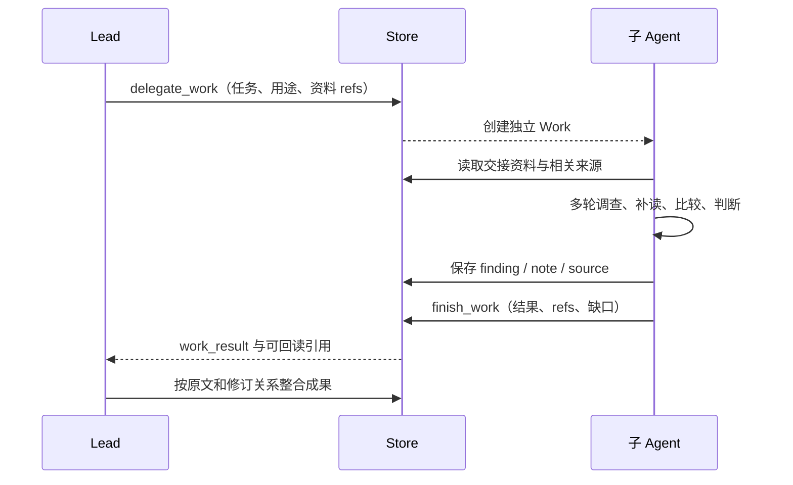
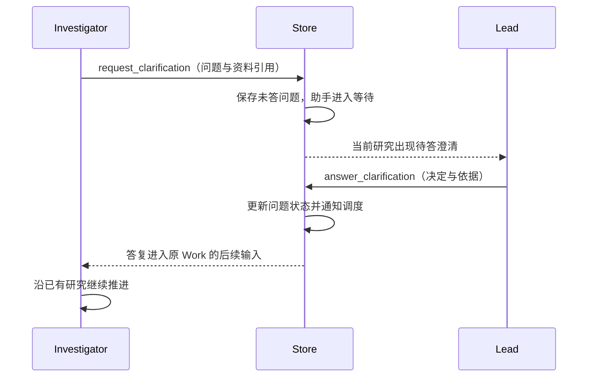
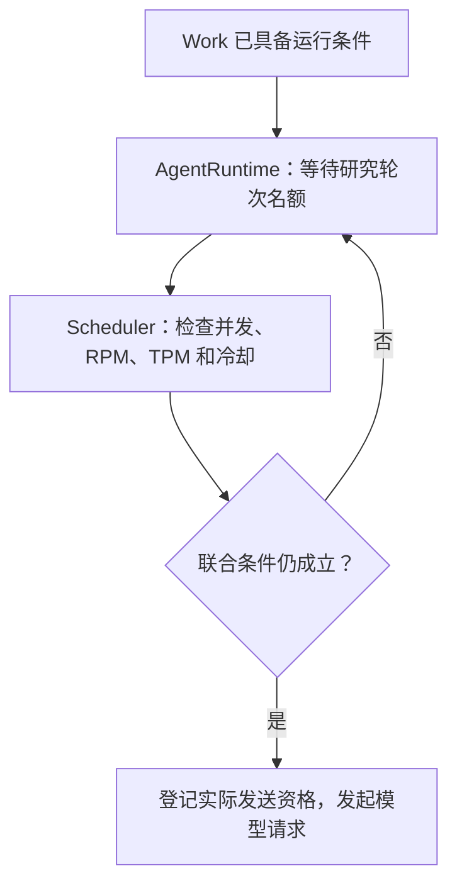
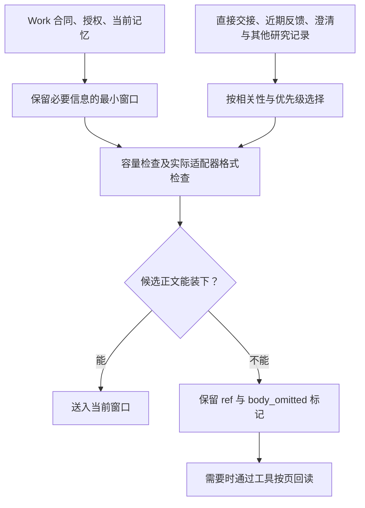
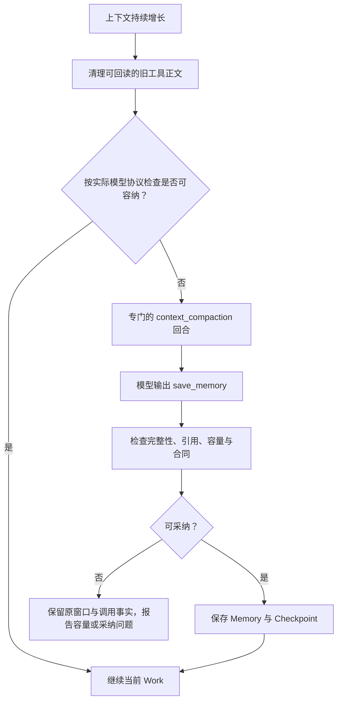

# 04 多智能体协作与上下文管理

第 03 章建立了一个 Work 的执行循环：它能读取任务、选择工具、取得反馈并持续行动。但复杂研究还有一个不同的问题：**当多个调查方向不断产生资料与推导时，怎样让负责人始终抓住全局，同时允许局部研究足够深入？**

Epivra 将主从式多 Agent 与上下文工程一起设计。Lead 维护总问题、研究方向和交付责任；助手通过独立 Work 处理具体调查或核查任务；持久化的资料引用让不同上下文之间能够可靠交接。每个 Work 又通过预算装配、工作记忆与检查点延续较长的研究过程。

Anthropic 在 [Effective context engineering for AI agents](https://www.anthropic.com/engineering/effective-context-engineering-for-ai-agents) 中将 Compaction（压缩）、Structured note-taking（结构化笔记）与 Sub-agent architectures（子 Agent 架构）并列为长任务上下文治理方法。Epivra 的实现恰好可以沿着这三条线理解：**多 Agent 分散局部探索，引用和笔记保存可回读的研究事实，压缩让每份工作持续运行。**

## 04.1 主从协作：角色、职责与独立上下文

Epivra 使用一个 Lead（研究负责人）协调当前研究方向。在需要深入调查、分歧核对或独立审稿时，Lead 委派助手，但仍负责将各部分成果组织成能够回答用户问题的整体研究。

| 角色 | 在研究中承担的工作 | 向整体研究交付什么 |
| --- | --- | --- |
| Lead | 维护全局目标、调整调查、整合证据并确认最终交付 | 当前方向的研究决策及正式报告 |
| Investigator | 围绕一个具体子问题深入查找与核对材料 | 判断、原始资料引用、适用条件与未解问题 |
| Synthesizer | 针对具体矛盾重新检查双方依据与口径 | 分歧原因、核对依据及其对结论的影响 |
| Writer | 接管正式稿的生成和修订工作 | 与当前研究依据对应的最新稿件 |
| Reviewer | 对指定问题或整稿进行独立审查 | 缺陷、修订意见或绑定稿件版本的裁决 |

这些角色不是必须逐个经过的流程节点。Lead 可以自己查阅资料或形成稿件；委派 Investigator、Synthesizer、Writer 的时机由当前研究任务决定。只有最终交付的审查与程序校验承担明确的质量门槛。

同一个模型可以承担不同角色，因为角色主要由 Work 身份、任务、系统指令和工具权限决定；项目也允许为调查、核实、写作与审稿分别指定模型配置。**模型选择决定使用哪种推理能力，角色授权决定可以执行哪些研究动作**，二者并不互相代替。

### 为什么选择一层委派

Epivra 的 Work 通过 `owner` 记录委派关系，当前研究方向只有 Lead 可以创建助手。存储层再次核对委派者的身份与方向，从实现上形成单层主从拓扑，而不仅是提示模型“不要继续委派”。

这一拓扑把总问题的规划、跨任务协调与最终交付集中在 Lead，同时把局部查找和判断放进助手自己的执行循环。对开放域研究而言，这是一种自然分工：大范围的独立资料调查可以并行推进，局部探索过程不必占满负责人的模型上下文。Anthropic 的 [多 Agent 研究系统工程文章](https://www.anthropic.com/engineering/multi-agent-research-system) 也把“独立上下文中的深入搜索、向负责人浓缩交付”作为研究型主从架构的核心价值。

Epivra 并不把不同 Work 的模型历史拼成一份共同对话。每个 Work 都有自己的任务、执行 step 和工作记忆；多个 Work 共享的是研究范围内已保存、可按引用读取的来源和成果。这种**工作上下文隔离、研究事实共享**的组合，是后续交接设计的基础。

## 04.2 怎样把“分任务”变成可靠的信息交接

假设 Lead 要研究某个多 Agent 架构的性能和证据可信度，准备委派一名 Investigator 核对性能实验。有效任务不应只是“搜索性能相关内容”，而应该明确：核查哪种架构、哪类实验、比较所需的评价口径、现有来源的精确引用，以及最后要返回的判断与证据。

在 Epivra 中，`delegate_work` 保存这份任务说明、必要引用、交付用途与所属 Lead，创建子 Work。新的 Work 通过自己的 Harness 循环进行调查；它不会继承 Lead 的全部私有对话，也不需要靠复制长篇背景材料才能获得已有证据。

这里的 `ref` 是 Store 中记录的稳定身份，包含归属与版本语义，不是单纯把网页 URL 从一个 Agent 复制给另一个。助手将重要研究判断保存为 `finding`，完成时以 `work_result` 交回其成果及相关引用。负责人获得局部结论后，可以沿引用回到原文或研究判断，检查新结果是否真正支持总问题。

### 默认聚焦与按需回读

Epivra 的 `_focused_research_refs` 会从委派输入和工作记忆里的引用出发，沿研究支持关系查找直接相关的记录，并考虑结论的修订版本。Investigat​​or 和 Synthesizer 的默认上下文不会平铺全部无关判断，但 `read_context` 仍提供共享研究目录的分页入口，`read_artifact_range` 等能力可以按需补读具体材料。

这不是简单的“上下文少一点”，而是**把完整的研究资料库留在外部，将当前最相关的证据送入模型窗口**。如果助手在一项实验中发现原先没有交接的定义，它仍有能力通过目录找到相关材料，再决定是否读取。这与 Anthropic 官方上下文工程文档所讨论的 Just-in-time Context Retrieval（按需检索上下文）原则一致。

当研究判断发生修订时，Epivra 不直接覆盖旧的 `finding`，而是记录新旧关系。之后的委派与聚焦输入可以携带当前修订，避免只看到旧结论却不知道前提已经改变。来源身份、工作输入与修订链共同构成**可核查的信息交接**，不是把助手摘要无条件当作全局真相。

## 04.3 内部澄清：让问题回到有决策权的角色

独立上下文提高了局部研究的专注程度，也要求系统处理跨任务的不确定性。

例如，Investigator 找到两份口径不同的结果，需要知道 Lead 当前研究目标更重视“所有任务平均表现”还是“复杂任务的尾部表现”。如果这是全局评价要求，助手不应该凭猜测决定。它可以通过 `request_clarification` 将具体问题、已查材料和引用保存给 Lead，然后在原 Work 中进入等待。

Lead 收到澄清，使用 `answer_clarification` 将答复及必要依据写入 Store，答案再进入助手后续的模型输入，助手无需丢弃此前进度重新创建任务。

系统必须同时处理等待关系。Lead 可能调用 `wait_for_work` 等待一个助手完成；但如果该助手反过来等待 Lead 答复，就形成“父等子、子等父”的停滞。Epivra 对这种明确的父子互等关系提供阻断和唤醒：不允许负责人继续等待已经因澄清而阻塞的子工作；若新澄清出现，则使相关负责人有机会恢复处理。

普通补充消息与控制动作也有明确分工：`send_work_message` 可以补充信息、要求中断或继续，`cancel_work` 则结束已不再需要的助手。中断不等于清空已保存证据，继续也不能绕过未答澄清；已经终结的 Work 不会因为收到普通消息自动重新开始。

**消息写入和模型实际收到消息是两种事实。** 每次请求会纳入有限数量的待处理消息；系统可以根据已完成、未被丢弃的模型请求判断一条消息是否已经进入输入，避免助手遗漏新的重要补充后直接提交结果。这里保存的是可核对的交接事实，而不依赖假设对方“应该看到了”。

## 04.4 并行调查与唯一写作者：对不同共享资源采用不同协作方式

调查型任务的成果主要是来源与判断，它们可以分别保存并由 Lead 整合；正式报告则是**同一研究方向上的共享文稿**。如果两个 Agent 从同一旧稿分别生成新全文，后一份保存可能覆盖前一个已经修正的数字、条件或引用。

Epivra 因此将并行主要用在独立调查，正式稿采用明确的写作权交接。默认 Lead 是当前作者；委派 Writer 后，当前正式稿的修改资格转给这一份写作 Work。Lead 仍可研究、核对材料和处理消息，但不会同时改写正式报告。

Writer 接管时，如已有当前稿，委派输入必须包含其准确引用；存储层保证同一研究方向不会同时存在多个活跃 Writer。保存新稿还要检查当前作者、当前 `base`（基稿引用）以及有效写作依据。基稿版本不匹配的修改会被拒绝，避免用过期版本覆盖新稿。

`draft_saved` 说明这份稿件保存成功，并不代表 Writer 的工作已经交付；写作助手仍需要 `finish_work` 明确结束。Reviewer 作为独立检查角色，可以对指定报告提出问题，但没有直接改写正式稿的权限。

这里同时体现两种正确性：**并行能力让研究覆盖更多方向，单一作者与基稿检查维护共享报告的一致性。** 形式上能把两个版本合并，不意味着被合并后的论证、条件和引用仍然一致；因此 Epivra 选择让正式写作沿着可核对的版本链推进。第 07 章会进一步讲精确 Patch、引用渲染与最终审稿。

## 04.5 动态调度：Work 的就绪与外部请求额度

多 Agent 能够并行，不等于所有 Work 都同时向模型供应商发送请求。Epivra 同时管理两类不同的资源。

第一类是**应用内 Agent 运行名额**。ResearchService 根据工作终结、显式等待、澄清和中断状态选出可运行 Work；共享的 `AgentRuntime` 再安排各研究的执行名额，当前默认容量为四个轮次。它使用进程内等待队列，并按研究轮转授予执行机会，使多个研究不会因为某一个研究持续创建工作就天然占满全部名额。

第二类是**外部供应商请求额度**。`Scheduler` 考虑同一资源的并发数、每分钟请求数（RPM）、预留 Token 数（TPM）和必要冷却期。模型请求不仅要争取应用名额，还要在真正发送前确认供应商额度仍然可用。

两个名额要联合检查，而不是先长期占住一个再等待另一个。例如某个 Work 等到 Agent 名额时，供应商的 RPM 额度可能刚被其他请求使用；系统需要重新检查，释放不应持续占用的资源，等待下一次可用时间再接纳请求。

这里需要特别区别“队列状态”和“研究状态”：正在等待的进程内队列不等于必须逐条持久化的业务事实；Work、控制、已发出的操作以及取得的回执则由 Store 保存。重启后，运行名额重新分配，研究凭持久状态接续。

并行工具调用是另一层：单个 Work 的一轮 Reply 也可能包含合格的并行外部工具请求，但必须遵守工具本身的并行声明与操作依赖。**跨 Work 并发、单 Work 内工具并发、供应商并发与速率限制是四个相关但不相同的概念。**

## 04.6 工作记忆、研究笔记与正式证据怎样分层

有了独立 Work，仍必须管理每个工作内部不断增长的上下文。Epivra 把三种经常混在一起的信息分开：

| 信息层 | 具体保存什么 | 后续怎样使用 |
| --- | --- | --- |
| 当前上下文窗口 | 本轮任务、工具、必要来源与最近观察 | 直接供模型进行这一次判断 |
| 工作记忆 Memory | 已完成进度、关键决策与条件、未解问题、下一步及引用 | 帮助同一 Work 跨轮次继续 |
| 持久研究记录 | Source、Note、Finding、Report 和工具回执等 | 保留可回读的事实依据、判断、产物及执行历史 |

`save_memory` 为当前 Work 写入新记忆，下一轮优先使用其最新版本，旧版本仍留在审计记录中。它适合保存“当前研究已经排除了哪种路径、还有什么问题待查、关键证据从哪里回读”，而不是把每份来源全文压成无法追溯的长摘要。

需要复用的解释可以保存为 `note`；对最终答案有实质影响、需要直接证据支持的判断则保存为 `finding`。这一区分对研究系统尤其重要：**记得自己此前认为某事成立，不等于已经具有能够支持该判断的原始证据。**

`pin_evidence` 可以固定当前 Work 必须保留的 source 引用入口。固定引用帮助后续回读，但不意味着来源全文永远放在模型窗口里。系统把可持久化的信息保存在窗口之外，再按当前任务需要选取内容，避免让长研究持续累积的每一条原文都竞争模型的注意力。

从通用 Agent 概念上看，这里实现的是**研究任务内的工作记忆和持久研究记录**。它不等同于跨研究形成用户画像、自动巩固长期经验、冲突融合和遗忘的完整长期记忆系统。明确这一点，是为理解具体设计服务，而不是否定当前实现的价值：Epivra 需要的是可追溯的研究进度、判断和事实依据。

## 04.7 上下文装配：有限预算如何承载持续增长的材料

理解 Context Window（上下文窗口）需要区分两个量：存储中有多少资料，与**本轮真正发送给模型多少信息**。

Epivra 的 `context.assemble` 首先保留任务合同、授权和当前工作记忆等必要内容，再根据明确交接、最新观察、澄清答复和近期记录等优先级安排候选材料。容量不是通过一次性把数据库全部读进模型来解决，而是优先放入相关内容，正文放不下时仍保留稳定引用与省略标记。

例如助手要核对一份长报告中的统计条件，Store 里可以完整保存这份来源；当前窗口先拿到来源身份、相关片段和能够继续读取的位置。如果模型需要上游的方法说明，再通过读取工具按页取得原文。不在窗口里的内容没有消失，模型却必须根据实际回读判断材料，而不能把引用本身当作已经读过原文。

预算还需要为模型输出留空间。Epivra 先依据配置窗口扣除最大输出额度，再使用 JSON 字符长度进行初步装配，由供应商适配器按实际发送格式和 UTF-8 字节长度保守核验。这里不使用一套适用于全部模型的精确分词器来计数；因此字符、字节和实际 Token 数不是一个量。对于未改变的历史前缀，适配器在满足条件时还可利用供应商返回的实际输入用量辅助估算新增长度。

**工具结果分页本身也要遵守容量。** `fit_read_result` 会在目标结果过大时缩小本次读取范围，并重新计算原文位置与下一页游标，保证结果仍是一页自洽、可以继续前进的内容。如果必要元数据和最小读取单位都放不下，就应报告容量错误，而不是悄悄截断正文让它看起来完整。

上述设计与 Anthropic 所强调的 Just-in-time Context Retrieval（按需获取上下文）一致：轻量引用与结构化入口负责定位，实际有价值的原文在需要时才进入本轮注意力预算。

## 04.8 压缩与 Checkpoint：让同一 Work 跨窗口继续

单份 Work 可能经历许多轮模型调用。即使每次都按需装配，连续消息和工具回执仍可能导致上下文持续变长。Epivra 使用两级处理，而不是直接抹掉全部历史。

**第一层是历史清理。** 对已经持久化且能够回读的不重要旧工具正文，系统在模型视图中改用引用和 `body_omitted` 标记，尽量保留近期结果、必要任务信息与工具调用/结果对应关系。这里改变的是模型看到的消息内容，Store 中保存的来源、观察与原始执行记录仍然存在。

**第二层是专门的记忆压缩回合。** 当清理之后仍无法容纳当前输入，Harness 为本次 Work 构造 `context_compaction` 请求，只暴露 `save_memory` 这一项保存工作记忆的能力。模型需要把目标、已经完成的决定、限制条件、未解决问题、下一步和必要引用整理成可持续使用的记忆。

Checkpoint（检查点）不只是摘要文字。它还记录这次压缩所依据的输入身份、前一份记忆以及覆盖到的 Observation 和 Note 序号（`through_seq`）。系统据此区分：哪些旧历史已由记忆概括，哪些是压缩之后新增、仍必须进入后续上下文的反馈。否则，新收到的工具结果可能被错误当成旧消息一起忽略。

程序要求压缩响应恰好包含一次合法的 `save_memory` 动作，检查文字非空、引用可读、新记忆能装进下一轮基本输入，再以事务保存 Memory、Observation 和 step 完成记录。如果检查失败，原始输入与已经发生的远程回执仍然保留，不能把一次不完整或不可用的摘要当作成功检查点。

另外，供应商原生协议所需的隐藏思考块和签名属于协议续接数据，不能在研究记忆里当作公开推导重写。Epivra 只使用可公开的正文、工具参数和结果构造压缩上下文，协议适配器维护自身合法续接所需的数据。

这一设计把“压缩”和“遗忘”区分开：**压缩是更新下一轮模型的工作视图，持久记录继续保存证据与完整执行事实。** 关键前提需要回到来源核查，不能因为记忆压缩成功就认为所有历史含义都被无损继承。

## 本章小结

Epivra 的多 Agent 与上下文治理是一条完整的工程链：

**Lead 拆解整体问题 → 助手在独立 Work 中深入调查 → 聚焦交接与按需回读控制当前上下文 → 研究记录保存来源与正式判断 → 澄清和消息保持跨工作协作 → 调度和写作权管理并发与共享状态 → 工作记忆、历史清理和检查点支撑长任务。**

这里有两个需要始终区分的“共享”：研究证据在授权范围内可共享、可追溯；各 Work 的私有执行历史和模型输入不默认合并。前者使协作有共同事实基础，后者使每名 Agent 能围绕自己的任务保持聚焦。

下一章会把视角移到外部环境：这些 Agent 取得的搜索结果、读取的来源、调用的 MCP 工具及分析能力，究竟如何在权限与可靠性约束下被发现、执行和保存。

## 本章源码索引

- [委派角色、单层主从与写作权管理](../../src/epivra/storage.py)
- [Harness：角色模型、聚焦引用、工作上下文、压缩与交接](../../src/epivra/harness.py)
- [ResearchService：助手交付、待答澄清与就绪调度](../../src/epivra/application.py)
- [AgentRuntime：研究轮转与进程内名额](../../src/epivra/agent_runtime.py)
- [Scheduler：RPM、TPM、并发与联合准入](../../src/epivra/scheduling.py)
- [Context：预算装配、历史清理、去重与分页回读](../../src/epivra/context.py)
- [WritingWorkspace：唯一作者、精确基稿与事务写入](../../src/epivra/writing.py)
- [模型适配器：历史前缀、请求容量与协议续接](../../src/epivra/adapters.py)
- [原生模型适配与可公开历史投影](../../src/epivra/native_models.py)

## 延伸阅读

- [Anthropic — Effective context engineering for AI agents](https://www.anthropic.com/engineering/effective-context-engineering-for-ai-agents)：上下文有限预算、按需读取、压缩、笔记与子 Agent。
- [Anthropic — How we built our multi-agent research system](https://www.anthropic.com/engineering/multi-agent-research-system)：研究委派、主从协作和上下文隔离。
- [LangChain — Multi-agent systems](https://docs.langchain.com/oss/python/langchain/multi-agent)：管理者、交接等常见组织模式以及控制权与上下文的配置。