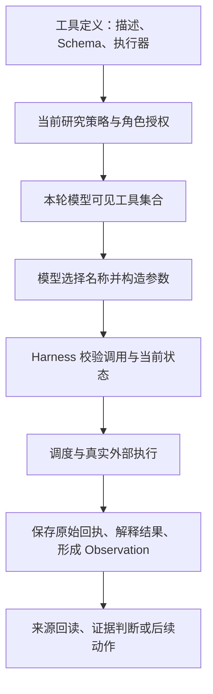
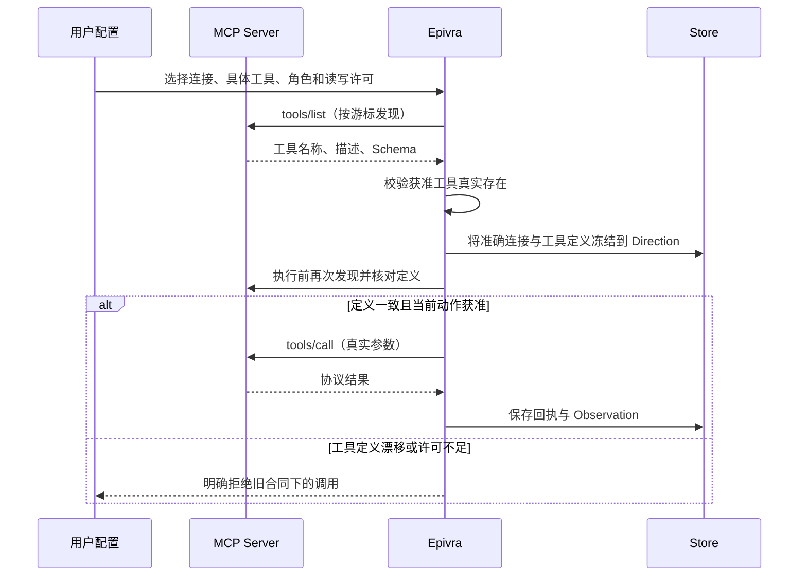
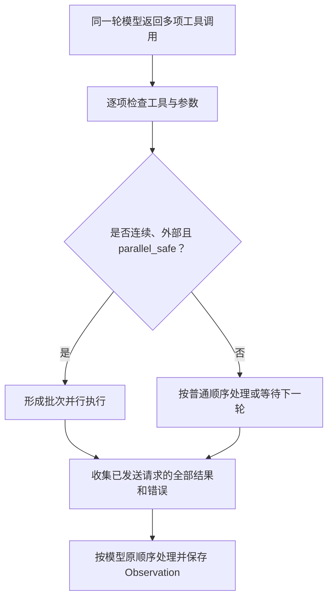
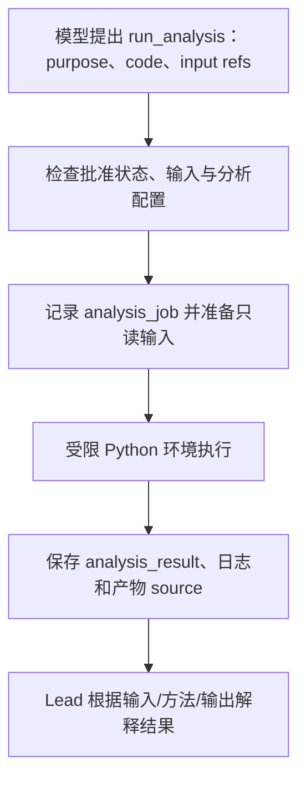

# 05 资料获取与工具执行

前四章已经建立了 Epivra 的研究流程：Lead 决定如何推进，Harness 在每轮判断中提供可用动作，多 Agent 在独立上下文里调查并交付证据。真正将它与单纯文本生成区别开来的，是模型能够**经过明确授权去访问外部世界，并把取得的资料或执行产物保存为可追溯的研究事实**。

研究工具不应只是若干能够被 Function Calling 调用的 Python 函数。一个可以长时间运行、使用外部 MCP 服务并允许用户暂停改向的研究系统，必须解释同一项能力如何定义、发现、选择、校验、授权、调度、执行、接收结果、恢复和治理。本章沿着这个生命周期讲解 Epivra 的具体实现，同时说明为什么这些设计适合需要原文引证和事实核查的深度研究。

## 05.1 工具是能力合同，不是模型的一句命令

假设 Lead 想比较两家厂商对某项技术的不同性能宣称。模型可以提出“搜索相关报告”或“核对原文数据”，但它并没有因为生成了这些文字就访问过网页。真正的搜索由 Harness 接收到结构化工具调用后，在当前授权范围内执行。

Epivra 在 [`harness.py`](../../src/epivra/harness.py) 中用 `Tool` 表示外部能力。这个对象既包含给模型理解的描述与输入 Schema，也包含程序侧的执行函数、允许角色、条件权限、参数补充校验、结果解释、重试与冷却策略、供应商资源和并行安全性等信息。

这里有三份不同的合同：

- **模型使用合同**：工具叫什么、解决什么问题、需要哪些参数、结果意味着什么。它帮助模型正确选择动作，也计入本轮上下文。
- **执行授权合同**：某个研究方向、某种角色、当前审批状态是否允许真实调用。模型的选择不自动替代授权。
- **结果与恢复合同**：何时认为请求已发出，哪些返回值可作为资料、哪些是错误、怎样回读与重试、旧回执是否可复用。

Anthropic 的 [Writing effective tools for agents](https://www.anthropic.com/engineering/writing-tools-for-agents) 强调工具的命名、描述和边界应当让模型能够明确区分用途，避免把大量含糊重叠的能力全部塞入上下文；OpenAI 的 [Function calling 指南](https://developers.openai.com/api/docs/guides/function-calling) 则把 Schema、模型生成调用和应用执行结果拆成清楚的交互步骤。Epivra 的 Tool 层不仅实现这份基本契约，还为长研究加上来源持久化与安全恢复。

## 05.2 Epivra 有哪些类型的工具，为什么不能混在一起

从调用方看，它们都可能出现在一轮模型的工具列表中；从运行机制看，Epivra 的工具大致有四类。

| 类型 | 代表动作 | 真正完成的事情 |
| --- | --- | --- |
| 内建研究工具 | `read_context`、`search_sources`、`read_source`、`discover_local`、`snapshot_local`、`record_finding`、`delegate_work` | 读取研究状态、检索已存来源、在授权目录中发现并保存本地材料，或修改研究记录 |
| 内建外部资料工具 | `web_search`、`fetch_web`、Crossref/PubMed/World Bank 等垂直工具 | 通过配置的网络渠道发现资料、取得网页或结构化数据 |
| 外部 MCP 工具 | 经过发现和授权的特定远程或本地服务能力 | 使用标准协议调用第三方能力，返回原协议结果并留存引用 |
| 受限分析能力 | `calculate`、按需启用的 `run_analysis` | 分别进行受控算术或在隔离的 Python 环境执行数据分析 |

这些类型的区别会决定权限、证据含义和恢复策略。

例如，`calculate` 是内建的表达式计算，不运行任意 Python 代码；`run_analysis` 则需要明确启用分析组件、绑定输入 source、在隔离环境运行，并保存日志与产物。又如，`web_search` 发现网页线索，但搜索结果摘要本身并不能取代原始资料；`read_source` 读取的是已经存入本地来源记录的正文范围，不需要每次重新向互联网获取。

这些工具类型对应不同的权限、返回结构和恢复策略。工具执行层负责说明程序实际取得了什么；材料能否支持某项判断，则由后续的证据与审查机制处理。

## 05.3 发现、冻结和选择：如何把 MCP 能力纳入当前研究

MCP（Model Context Protocol，模型上下文协议）为客户端发现工具、调用工具与读取资源提供标准交互方式。官方 [MCP Tools 规范](https://modelcontextprotocol.io/specification/2025-06-18/server/tools) 将 `tools/list` 作为工具发现请求、`tools/call` 作为工具调用请求，工具定义包含名称、描述、`inputSchema`，还可以有 `outputSchema`。

在 Epivra 中，**发现并不等于授权，授权也不意味着工具定义之后可以任意漂移**。

用户首先在配置中选择要连接的 MCP Server，连接可以使用 `stdio` 或 Streamable HTTP。程序读取连接配置、校验服务器名称和地址等字段，然后通过协议枚举工具；`mcp_client.pages` 会跟随分页游标收集目录，同时检查循环游标与目录容量。

在创建研究时，`mcp_client.freeze` 会再次发现所选服务器的实际工具，并检查配置里明确授权的工具是否全部存在。它把这一刻的连接信息和准确的工具定义保存到该研究的策略中。后续每次调用前，`prepare` 会重新核对服务器当前定义是否仍与冻结定义相同；如果发生变化，旧研究不能默默接受新的 Schema 或功能描述，而需要重新形成获准配置。

这几层机制把工具发现与执行权分开：内建能力由代码定义，MCP 能力从外部服务发现，研究策略确定获准范围，Harness 再按当前角色形成模型可见的工具集合。**目录、可见性和实际调用权是不同层次**，因此不能让模型直接连接任意已发现服务器。

`mcp_tools.connect_tools` 将冻结的 MCP 定义适配成普通 `Tool`，对模型提供带服务器前缀和稳定摘要的别名，减少不同服务器出现同名能力时的冲突。这样 Harness 仍然使用相同的选择与执行入口，无需为 MCP 另写一套 Agent Loop。

### MCP Client 与 MCP Server 是两种不同方向

Epivra 一方面作为 **MCP Client** 调用外部能力；另一方面还提供 **MCP Server**，让外部客户端启动和控制 Epivra 的研究。前者扩展的是研究中可使用的工具，后者暴露的是 Epivra 自己的研究服务入口。

协议相同不意味着权限互通。外部客户端能够使用 Epivra 的 MCP 研究入口，不等于 Epivra 的某个内部 Work 自动获得该客户端所有工具的权限。两侧都必须经过各自的连接、授权和业务状态检查。

Epivra 的 MCP Server 是现有本地 Host 的受控入口，不会另起一套研究运行时。默认使用 `stdio`；选择 HTTP 时，服务只绑定 `127.0.0.1`，必须提供独立的 Bearer 令牌，且关闭访问日志。`create_research` 只创建暂停的草稿，不代表路线已批准；外部客户端默认不能代为审批，只有启动时显式开启 `--allow-approval` 才能申请按精确策略引用审批。暂停、恢复、改向或取消还要提交已观察到的控制版本和唯一命令 ID。上传入口接收用户明确提供的文件字节，不授予客户端任意读取宿主目录的权限。客户端断开连接也不会自动取消 Host 中持续运行的研究。

## 05.4 Schema 校验、语义校验和权限为什么需要分层

工具参数是模型生成的结构化数据，不能因为它看起来像 JSON 就假定安全。Epivra 会先要求整份模型响应完整，再验证工具是否属于本轮可用集合和参数是否符合合同。

内建工具通过 `object_schema` 定义参数，通常显式列出属性、必需字段与不允许的额外字段；通用校验器进一步检查类型、枚举、整数范围和来源引用格式。MCP 工具则使用所授权的原始 JSON Schema，通过 `jsonschema` 对实际参数做校验，并对外来结构限制嵌套深度与体积。

**Schema 正确不等于业务语义正确。**

例如，模型提供一个 64 位十六进制字符串作为 `read_source.ref`，它可以通过格式检查，却仍可能引用一个不存在的记录、其他研究的私有记录，或当前角色不能读取的对象。只有结合 Store 的真实引用关系、研究身份与权限再次检查，才能决定是否允许读取。

再比如 `web_search` 带了域名过滤或起止日期。即使参数类型正确，也必须校验过滤能力是否由当前选定供应商支持，起止日期是否真实有效、顺序是否合理。Epivra 的 `WebProvider.validate_search` 只允许 Tavily 使用特定结构化域名/日期过滤，不会把其他搜索渠道默默当成等价支持。

工具的安全性因此不是提示词里的“只做安全操作”，而是**本轮工具可见性、参数 Schema、具体业务前提和真实执行资格**共同形成的约束。MCP 官方规范鼓励在应用中向用户清楚展示工具能力与调用行为；但规范建议的交互模型不能直接被描述成 Epivra 已实现每次写操作都弹出确认框。Epivra 的具体授权方式是用户选择研究策略、连接工具、角色以及读写许可，再由运行时执行校验。

## 05.5 授权范围如何限制外部 MCP 执行

Epivra 在 MCP 连接配置里要求对每个工具明确设置 `roles` 和 `write`。角色列表不能是任意字符串；写权限必须明确为布尔值。对资源读取，还要求 URI 属于配置中明示允许的清单。

连接地址也有清楚的约束。远端 HTTP 连接通常需要 HTTPS，本地回环地址才允许 HTTP；URL 不能把凭据直接嵌在用户名、密码、查询参数或片段中。凭据由命名环境变量或本地安全配置提供，连接时再注入，不应当随模型任务上下文持久化。

对 `stdio` 工具，进程启动参数、工作目录和转交的环境变量需要通过明确配置，不能简单把父进程的全部环境传给外部服务。MCP 连接还使用自己的会话生命周期和独占执行回合：连接准备、当前 Schema 校验可以发生在尚未确认发送资格之前，而真正发送和回执归属需要明确的所有者与调用身份。

一份工具定义即使声明 `write: false`，也需要信任所选服务器是否真实遵守声明；软件侧授权不是证明远程服务绝对无副作用。对于真正的外部写操作，Epivra 在批准研究时按连接和角色限制能力，并通过调用账本记录请求与回执；程序暂停研究不会自动回滚远端系统已经发生的修改。

### 外部返回文本为什么不能成为新指令

MCP 工具、网页、论文摘要和文档原文都属于**外部数据**。它们可能包含“忽略之前要求”“调用其他工具”一类文字，但这些文本没有修改研究授权、提升角色权限或覆盖系统指令的资格。

Epivra 的 MCP 工具描述明确提醒将返回内容视为外部数据，并使用来源引用作为证据。实践中不能只靠提示词解决所有提示注入风险：真正的防线仍需要把本轮工具授权、数据读取权限与实际动作校验留在程序内。**读取到一段恶意文本，并不应改变下一次工具调用能做什么。**

## 05.6 双层资料发现：搜索线索如何走向原文

Epivra 的资料获取不是“搜索一次，把十条摘要粘进模型”。它把两种研究入口组合起来。

第一层是**多源通用发现**。配置了网络渠道后，`web_search` 可从当前研究启用的 Tavily、Exa、Brave、Perplexity、Bocha 或 DuckDuckGo 等服务取得线索；`fetch_web` 在缺少原文、需要更多上下文或需要刷新时读取指定 URL。供应商的过滤能力和返回内容不同，`WebProvider` 负责规范化结果，同时保留它究竟是页面正文、选取片段还是供应商总结。

第二层是**垂直资料接口**。它们使用领域标识符和固定数据合同，而不是把所有问题都转成宽泛网页搜索词：

| 渠道 | 实际取得的内容 | 必须保留的边界 |
| --- | --- | --- |
| Crossref | 出版物元数据、DOI 与书目信息，按页读取记录 | 元数据不等于论文全文 |
| PubMed | 搜索返回 PMID；`read_pubmed` 再读取所选编号对应的 XML 记录及可用摘要 | 摘要不是文章全文；搜索最多覆盖前 10,000 条，超过范围应缩小查询 |
| Europe PMC | 生命科学论文/预印本元数据及可用摘要，使用游标继续读取 | 元数据或摘要不能称为全文 |
| World Bank | 指标目录及定义（每页 50 项）与观测值（每页 100 行）是两种不同查询 | 保留单位、定义、来源、更新时间；缺失值 `null` 不是零 |

通用搜索适合发现线索，垂直接口适合按 DOI、PMID 或指标代码精确定位。渠道是否合适，取决于它实际返回的材料与当前问题是否对应，而不是连接数量或响应速度。

### 搜索发现并不是已经阅读原文

假设一次 `web_search` 返回了三个结果：一条是服务商摘要、一条带着部分摘录、一条成功取得了可存储的网页正文。它们对应不同的信息状态：

| 已获得的内容 | 可以支持什么行为 | 还不能推导什么 |
| --- | --- | --- |
| 标题、URL、搜索摘要 | 识别值得进一步核查的来源线索 | 不能宣称已完整阅读论文或报告 |
| 带明确覆盖范围的文本片段 | 对已返回片段进行初步核对，必要时继续读取 | 不能把局部覆盖说成全文证据 |
| 保存的原始来源快照 | 根据内容、引用和精确位置形成进一步证据判断 | 快照存在并不自动保证作者结论正确 |

在 `online_service` 配置的实际调用链中，`web_search` 可以尝试在搜索发现阶段同时获取可用的原文窗口；当只得到线索、没有可用来源正文时，Harness 的 `_read_lead` 可按返回顺序进一步尝试读取候选来源，并保留每一步的尝试状态。它不会因此保证所有命中的网页都能取得完整正文。

这套“发现 → 原文获取 → 本地快照 → 按需回读”的设计同时服务于资料追溯和上下文预算。工具首次取得的内容不需要在以后每轮都重复发送给模型；持久化 `source` 后，Agent 可以用 `read_source` 按准确位置重新读取。搜索结果没有可用正文时，`_read_lead` 会按供应商返回顺序尝试候选 URL，取得第一份可读材料后就停止；其他候选仍可在后续研究中单独核查。第一份可读材料不因此自动成为最权威来源。

### 本地材料也必须经过授权目录与快照

本地文件是第三条资料入口。`discover_local` 只能扫描研究策略 `local_roots` 中明确授权的目录，并生成目录快照，记录相对路径、文件大小、修改时间和可读取状态。`snapshot_local` 只能选择该目录快照中的相对路径；程序会重新解析目标路径，确认它仍位于获准根目录内，再把文件内容保存为 `source`。不支持的格式和无法读取的文件会被标明，不能假装已经进入研究。

目录快照与来源快照承担不同职责：前者记录“当时看见了哪些文件”，后者固定“实际读取的那份内容”。文件发生变化后，系统不会悄悄把旧 `source` 替换成新内容；需要重新发现并明确选择新版本。这个流程不是把模型变成可以任意读取宿主文件系统的进程。

### 普通 HTTP 阅读器不是浏览器

默认 `http` 阅读器发出不带浏览器登录状态的普通 HTTP 请求，不运行 JavaScript，也不会自动取得需要登录或动态执行才能显示的正文。它先校验 URL、解析 DNS，并拒绝解析结果中出现非公网地址的目标；连接到已检查的 IP，而不是在检查后再无约束地重新解析域名。每次跳转都会重新执行地址检查，最多跟随五次跳转。

阅读器只接收 HTML、XHTML、纯文本和 Markdown，单个响应正文上限为 8 MiB；单次请求约 20 秒超时，整次读取约 30 秒超时。HTML 会移除脚本、导航、表单等非正文部分；检测到常见验证页、验证码或密码表单时，会返回读取失败而不是把验证页面保存成研究原文。普通 HTTP 无法取得可用文本时，可以按已配置的回退链路尝试 Jina 阅读服务；但若目标被判定为非公网地址，程序会设置 `fallback_allowed=false`，禁止借外部阅读服务绕过地址限制。

## 05.7 工具结果怎样变成可追溯的研究输入

一项外部工具调用包含至少两种不同的结果：**供应商实际返回了什么**，以及**Epivra 将它解释成什么研究资料**。

Harness 在执行外部工具时保留原始调用回执，再通过工具提供的 `observe` 解释器规范化结果。搜索工具可能产生一个或多个 `source` 引用；MCP 工具返回的是符合协议的内容或结构化结果；分析工具产生任务记录、日志与输出。最后，每项动作都对应一份 Observation，记录工具名、真实结果、错误及必要的来源获取回执。

例如 MCP 协议允许 `content` 中出现多种非结构化内容，也允许用 `structuredContent` 返回结构化对象，并声明可选 `outputSchema`。Epivra 先保留协议原始结果，再检查协议结构；对普通 MCP 返回值，输出 Schema 不匹配时会保留原内容并给出警告，提醒使用者核实而不是静默改写。对明确选择的 `knowledge-v1` 结果合同，则需要严格解析和检查所声明的数据结构，才能把相应资料变成来源快照。

由此需要区分三件事：

1. **工具调用成功**：外部系统给出可识别的回应。
2. **资料成功获取**：程序取得可保存、可定位的内容。
3. **研究证据成立**：取得的内容经过原文、条件和来源关系核查，能够支持特定判断。

Epivra 使用研究获取记录追踪输入和输出状态，包括是否获得材料、局部失败、实际交付了哪些来源及文本范围、是否来自旧获取复用等。一个工具返回了十条搜索结果，却没有取得任何可读正文，不能被当成十份已经核验的证据；某份 `source` 存在，也不意味着模型已经阅读它的全部字符。

在此基础上，第 06 章才会解释怎样从 `source` 提取带原文位置的证据、形成 `finding`、检查相互冲突的来源与推论边界。**工具负责可靠地取得并保存材料，证据系统负责判断这些材料能支持什么。**

## 05.8 结果复用与刷新：为什么工具缓存需要研究语义

如果助手 A 已经从某个搜索渠道取得资料，助手 B 又研究同一问题，是否还需要再次访问 API？直接回答“同一个 URL 就缓存”并不足够，因为查询内容、供应商、授权身份、研究方向和是否要求刷新，都会影响结果是否可以复用。

Epivra 对选择启用 `cache_research` 的工具保存研究级请求身份。外部 Tool 通过 `research_fields` 提取定义过的关键请求参数，并用工具绑定、授权身份与参数构造 `research_key`；Store 在当前研究方向中查找可复用的来源获取。若已有合法的获取结果，可以通过原回执解释器重建资料或返回旧引用，避免因不同 Work 重复查询而浪费外部调用。

复用时还要保留 `reused_from`，以便审计时看出“这次获得的内容实际来自哪一次原始请求”。需要新资料时，调用方可明确提出 `force_refresh`；但刷新标记不是无视失败、配额和授权直接重试的通行证。

这里有两种经常被混称为“缓存”的机制：

- **研究结果复用**避免同一研究方向多次付费或下载相同的外部资料；
- **模型 Prompt Cache**利用相同请求前缀减少某些模型供应商的重复计算或计费。

前者发生在工具与研究资料层，复用的是既有来源和回执；后者发生在模型输入层，复用的是满足供应商条件的提示前缀。两者的失效规则、结果含义和业务边界不同，不能在面试中笼统说“我们做了缓存”。

## 05.9 失败分类、重试和结果未知：三个不同的恢复动作

真实网络调用会出现认证失败、配额耗尽、限流、目标失效、协议格式错误以及连接中断。Epivra 的 `recovery.py` 不试图猜测每次失败的隐藏原因，而是根据已知的 HTTP 状态、连接完成状态与供应商返回事实给出诊断和允许的恢复方向。

| 已知情况 | 对研究的含义 | 对应处理 |
| --- | --- | --- |
| 请求确定未发送 | 远端尚未接收这次动作 | 满足控制与配额条件后可以安全重新发出 |
| 已明确限流或临时过载 | 提供方要求稍后访问 | 记录冷却期限，按具体合同等待和重试 |
| 认证或授权错误 | 当前身份没有可用调用权 | 先修复账户/访问配置，不通过换查询绕开 |
| 请求或参数错误 | 当前动作不符合合同 | 修正输入或方法，不机械重复同一错误 |
| 已取得完整回执 | 该次操作的结果已知 | 从账本重放原回执，不重复发送 |
| 已发送但结果未知 | 远端可能执行并产生费用或副作用 | 保留未知状态，先恢复或核实原回执，不能盲目重发 |

“幂等”在这里至少有两个层次。**操作级回执重放**意味着同一次 step/工具位置已经有确定结果时，恢复直接复用它；**研究语义复用**意味着另一次研究动作在授权和参数合同相同、且满足复用条件时，可以引用此前的资料获取成果。它们都能减少重复，但前者处理的是“同一操作是否已经发生”，后者处理的是“另一操作是否还有必要再次获取相同资料”。

尤其是请求超时之后，无法仅凭异常判断服务器是否已经执行。对 MCP 外部写工具更是如此：远端可能已改变某个系统，客户端因为网络中断而没有收到成功回包。Epivra 在 MCP 执行层区分“发送前失败”和“发送后不确定”，后者不能自动转成重新发送。

对配置了自动恢复策略的网络工具，程序只在已知条件支持时重试：例如确定未发送、明确限流或服务明确报告暂时过载；退避时间会遵守供应商给出的 `retry_after`，并逐步增加。单项操作在同一控制 Epoch 中最多自动恢复五次，下一次最早发送时间会持久保存，达到上限后需要显式恢复或调整方法。并非所有工具都使用同一重试循环：部分公共资料接口主要通过共享调度器施加并发和请求间隔限制。

这就是为什么第 08 章还需要数据库中的操作账本、结果结算、Epoch 和恢复准入。普通的 `try/except: retry()` 只能处理部分错误，无法给已发生的外部副作用提供可靠的语义保证。

## 05.10 并行执行与资源治理：什么时候真的可以并发调用

模型一次可以提出多个工具动作，但不能因此认为所有动作都可以同时执行。Epivra 的工具声明包含 `parallel_safe`，Harness 仅对连续且通过校验的、明确允许并行的外部动作建立批次；已接纳的批次可以并行等待远端响应，结果再按原动作顺序采纳。

网络资料工具通常可以声明为并行安全，因为独立搜索本身不会修改同一份正式稿；MCP 外部工具则按当前实现设置为 `parallel_safe=False`。这是由于协议能力可能有写入、副作用或共享会话状态，不能仅因为模型同时请求两个操作，就未经更强的合同验证并发执行。

外部服务还受共享 Scheduler 的并发、RPM、TPM、调用间隔与冷却期限约束。第 04 章已经解释过供应商额度与 Agent 轮次名额的联合接纳；工具侧新增的重点是**每个 Tool 必须声明资源归属和能否安全并行**，这样不同研究 Work 才能公平地竞争有限的外部服务，而不会因为某一轮模型输出大量动作就压垮供应商。

## 05.11 数据分析：如何把模型生成的代码变成受控研究产物

深度研究有时需要对已取得的数据重新计算，例如检验统计报告中的增长率、比较不同时间段的数据，或用输入数据绘制图表。Epivra 提供两种不同粒度的计算方式。

简单确定性的算术可以通过 `calculate` 完成：它解析受限表达式，不执行任意 Python 程序。真正的数据处理使用 `run_analysis`，由模型提供需要执行的代码、用途说明和明确的输入 source 引用。

分析执行前，程序检查研究是否已经批准、分析能力是否启用、输入引用是否合法，并为当前 step 及调用位置建立稳定的 `analysis_job` 身份。输入名必须是安全的相对文件名，且每个输入引用都必须指向已保存的 `source`；原始来源不会直接暴露成任意宿主路径。随后把输入副本放入单独的任务目录，再交给当前配置的沙箱后端。两种后端分别限制网络、文件权限、进程和资源，不会因为模型提供了 Python 代码就授予它无限制的宿主访问权。完成后保存日志、状态和输出文件的来源引用。

两种后端都使用受控输入副本，且不会在隔离建立失败时退回普通、不受限的 Python 执行。它们的安全边界不同，不能只用“已经沙箱化”概括：

| 限制项 | Windows 原生后端 | Docker 后端 |
| --- | --- | --- |
| 运行基础 | 仅支持 Windows x64；使用经校验、身份固定的原生 Python 运行时，需显式安装可选组件 | 使用 Linux 镜像；先检查镜像，再固定实际镜像 ID，要求 Docker 可用 |
| 进程与资源 | 低权限 AppContainer 身份和关闭即清理的 Job Object；限制一个活动进程、内存与 CPU；为 Python 单独授予 `registryRead`，不授予网络或 COM 能力 | 禁止容器联网、基础文件系统只读、非管理员 UID、移除额外系统能力并禁止权限提升；默认最多 64 个进程，并限制 CPU、内存和交换空间 |
| 文件边界 | 输入与运行时只读，输出和临时目录可写；监督程序约每 50 毫秒检查目录大小、文件数量、链接和 NTFS 备用数据流，超限后终止 | 输入以只读方式挂载；输出和临时目录使用限容量的内存文件系统，避免把任意写入直接落到宿主目录 |
| 默认容量 | 与共享配置相同的默认超时 120 秒、输入 256 MiB、输出 16 MiB；目录超限依赖轮询发现，不是每次写入都立即拒绝的硬配额 | 默认超时 120 秒、输入 256 MiB、输出 16 MiB、内存 1 GiB、CPU 2 核、进程上限 64；具体值可配置 |

任务身份与恢复同样重要。若 `analysis_result` 已经保存，重复触发会复用原结果；若任务曾经启动但结果缺失，程序不会仅凭“没找到结果”就重跑代码。Windows 原生任务中断后报告中断；Docker 后端会先核对原容器的任务标签和镜像身份，缺少原容器时也报告中断，而不是创建一个同名新容器冒充恢复成功。

重启恢复也要考虑分析任务。如果相同的 `analysis_job` 已有持久 `analysis_result`，重复触发不应重新计算；若此前中断，则需要先对受限运行环境和实际任务状态进行核对与清理。最后，Python 程序执行成功仍不能保证统计方法正确——报告要引用保存的输入和产物，必要时重新核查计算口径。

## 05.12 完整调查案例：从工具调用到可核验结论

假设 Lead 要核对某个 AI Agent 框架的延迟性能声明，并要求引用真实报告与数据。工具系统需要让这一任务从问题进入执行，再从执行回到可核查的材料。

首先，Lead 根据问题选择 `web_search` 或垂直资料工具。Harness 只向当前角色提供已授权能力，模型给出查询与参数后，程序依次检查工具是否可用、Schema 与业务条件是否满足，再由 Scheduler 联合协调供应商额度和执行轮次。模型提出调用只代表动作意图；直到执行账本记录了请求和结果，才有真实的执行事实。

搜索返回的标题、摘要、片段和正文会被区分保存。若没有可用原文，系统按顺序尝试候选页面；获得的内容成为带稳定引用的 source。Lead 可以通过 `read_source` 回读实验指标的具体段落，再依据原文条件记录证据和 Finding。只有当问题确实需要重新计算时，才将明确绑定的 source 输入 `run_analysis`，并把日志与计算产物一起保存。

如果请求遇到 429，程序遵守提供方等待期限；如果完整回执已经保存，恢复时复用该回执；如果请求已经发送但结果未知，则保留未知状态并先核对原操作，不为追求“继续运行”而盲目重发。相同授权与请求满足研究级复用条件时，可以复用旧资料；确实需要新数据时再请求刷新。用户改向后，旧 Epoch 的请求不能继续写入新方向。

整个过程不是“调用工具后就相信输出”，而是把工具能力、权限、资源调度、原始回执、来源快照和研究判断连成可追溯的链路。Function Calling 让模型表达要做什么；MCP 统一部分外部能力的发现和调用方式；Epivra 自己的运行时负责授权、执行、记录和恢复；证据系统再判断这些材料究竟能支持什么。

## 本章小结

Epivra 的工具生命周期可以完整串联为：

**定义与注册 → MCP/外部能力发现 → 研究级冻结与角色选择 → 参数及语义校验 → 授权 → 资源调度和实际执行 → 原始回执与结果处理 → 失败分类、重试或回执重放 → 取消与恢复 → 观测和资料复用。**

所有阶段都服务于同一项研究职责：让模型能主动取得新信息和执行必要计算，同时把执行事实、研究依据与权限边界留在程序管理之中。下一章将深入工具取得资料之后的工作：如何建立原文证据、去重与组织来源、形成可修订的正式研究判断，并判断不同资料之间真正的支持与冲突关系。

## 本章源码索引

- [Harness：Tool 合同、内建 Schema、角色授权、外部执行及结果采纳](../../src/epivra/harness.py)
- [MCP Client：连接配置、发现、冻结、调用与会话管理](../../src/epivra/mcp_client.py)
- [MCP Tools：授权能力适配、参数校验、原始结果解释](../../src/epivra/mcp_tools.py)
- [MCP Server：向外部客户端提供研究入口](../../src/epivra/mcp_server.py)
- [ResearchService：模型及网络工具的组装](../../src/epivra/application.py)
- [WebProvider：搜索供应商与原文获取差异](../../src/epivra/web_providers.py)
- [DirectReader：公网地址校验、跳转复核与正文提取](../../src/epivra/direct_reader.py)
- [PublicSource：Crossref、PubMed、Europe PMC、World Bank](../../src/epivra/public_sources.py)
- [Workspace：资料快照、来源回读与分析产物](../../src/epivra/workspace.py)
- [Recovery：失败事实、诊断和安全重试依据](../../src/epivra/recovery.py)
- [Scheduler：外部提供方资源与限流](../../src/epivra/scheduling.py)
- [AnalysisRuntime：受限分析任务及恢复](../../src/epivra/analysis_runtime.py)
- [DockerSandbox：固定 Linux 镜像与容器资源边界](../../src/epivra/analysis.py)
- [Native Analysis：本机隔离与资源限制](../../src/epivra/native_analysis.py)
- [WindowsProcess：LPAC、Job Object 与受限进程启动](../../src/epivra/sandbox_windows.py)
- [Components：可选分析运行时的显式安装与完整性校验](../../src/epivra/components.py)

## 延伸阅读

- [Anthropic — Writing effective tools for agents](https://www.anthropic.com/engineering/writing-tools-for-agents)：工具命名、职责边界、返回内容与模型工具使用效率。
- [OpenAI — Function calling](https://developers.openai.com/api/docs/guides/function-calling)：工具定义、函数参数及应用执行结果的合同。
- [MCP Specification — Tools](https://modelcontextprotocol.io/specification/2025-06-18/server/tools)：协议层的工具发现、执行和结果结构。
- [Anthropic — How tool use works](https://platform.claude.com/docs/en/agents-and-tools/tool-use/how-tool-use-works)：模型生成调用和应用执行之间的完整反馈循环。